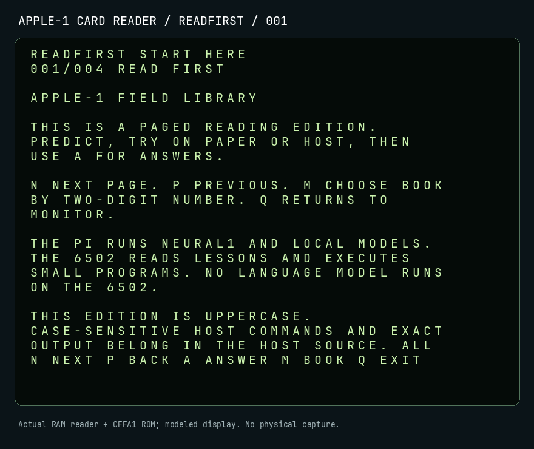

# Apple-1 / Replica 1 Plus / NEURAL1

**Explore early computing. Build constrained AI experiments. Check what actually happened.**

A project by [Alex Kaper](https://github.com/SquirmyWormy275) combining an
Apple-1 replica collection, programming lessons, and a Python research lab.
The central question: **what can a small language model do when its tools are
limited to the memory and commands of an early personal computer?**

The lab, **NEURAL1**, runs on modern hardware and executes programs in a virtual
Apple-1 world. Models propose commands; deterministic execution checks them;
**META/1** connects recorded claims to their evidence.

[Read the worked textbook](docs/textbook/README.md) ·
[Start the walkthrough](docs/neural1/getting-started.md) ·
[Explore the wiki](wiki/Home.md) ·
[Review the engineering](wiki/Project-Highlights.md) ·
[Current status](docs/STATUS.md)

## What you can do here

| Explore | What you will find | Begin with |
|---|---|---|
| Learn early computing | 42 lesson packets with activities, sources, answers, and prerequisites | [What is an Apple-1?](docs/field-library/S01-what-is-an-apple-1/README.md) |
| Read the card edition | Main books, saved BASIC programs, full readings and preserved originals | [CF-card library](wiki/CF-Card-Library.md) |
| Try the software | A repeatable demonstration using fixed test responses and virtual execution | [Five-minute walkthrough](docs/neural1/getting-started.md) |
| Study model behavior | Five experiment families covering memory, historical design, rebuilding tools, small programs, and shared-memory interaction | [Experiment guide](wiki/Experiments-and-Discoveries.md) |
| Examine the engineering | Recoverable workers, storage checks, snapshots, evidence records, and verified exports | [Project highlights](wiki/Project-Highlights.md) |
| Explore the physical collection | Replica provenance, display research, and an enclosure design | [Builder and collection guide](wiki/For-Builders.md) |

## Try your first example

You need **Python 3.12 or newer**, Git, and a terminal. The demonstration needs
no model download, Pi, GPU, or physical Apple-1 connection. On Linux or macOS:

```bash
git clone https://github.com/SquirmyWormy275/apple1.git
cd apple1
python3 -m venv .venv
source .venv/bin/activate
python -m pip install -e .
python -m neural1.demos --out out/my-first-demo
```

Already have a checkout, or using Windows? Follow the
[setup and walkthrough](docs/neural1/getting-started.md#1-prepare-a-development-checkout).
Use a new output folder for a separate demonstration.

The command prints a run ID, the path `out/my-first-demo/summary.json`, and
`"serial_opened": false`. Open that JSON file in your editor. In
`4k_mind.transcript`, one participant's program writes the number 42 to memory;
another reads it back as hexadecimal:

```text
0300: 2A
```

That is a small, inspectable result: deposited bytes produced a recorded memory
value. The demo uses fixed responses and is labeled **prototype software-test
evidence**, not an LLM research finding. The
[walkthrough explains the other fields](docs/neural1/getting-started.md#3-read-one-result).

## Worked textbook

The [textbook](docs/textbook/README.md) connects the system end to end: 15
chapters, worked companions for all 42 Field Library lessons, eight local-model
labs, 36 feature demonstrations, twelve deeper CPU labs, and fresh native
model recordings. Six real BASIC labs and four card labs extend the course.
Each of the 110 catalog examples has executable
source, actual captured output, an image, checks, and a practice variation.
[Choose a course route](docs/textbook/course-guide.md),
[inspect the fresh native runs](docs/textbook/native/README.md), or
[review the corrections](docs/textbook/review.md).
[Coverage and environment-dependent limits](docs/textbook/coverage.md) distinguish
host/virtual fixtures from real-model and physical procedures.

A fresh Pi capture executes a small program and retains the exact bytes and
trace. The native guide also shows failed model proposals and independent checks.


## The flash-card edition

The [combined CF-card library](wiki/CF-Card-Library.md) was installed and fully
read back on October 28, 2026. Its **386 files** include all six original
programs, the **50-book main library**, **six saved Integer BASIC programs**,
319 supplemental readers, and an exact-source archive. The supplements include
all 15 textbook chapters, 42 worked companions, teacher/visitor material,
source notes and all 110 captured example outputs.

On a working Replica/CFFA1, select prefix `EDUCATION`, load `READER` at `$0800`,
quit to Monitor, then enter `0800R`. The root `START.HERE` overview and the
supplemental readers use `$1000`; the [loading guide](cf-card/DEPLOYMENT.md)
explains both interfaces.

The [installation audit](cf-card/AUDIT-2026-10-28.md) verifies the complete
media copy and unchanged originals. Physical Replica display/keyboard and
serial acceptance remain pending. Python and model inference run on the host.

[Download the built content](cf-card/releases/README.md) ·
[Browse the six originals](cf-card/original/README.md) ·
[Run real Integer BASIC](docs/textbook/reference/basic.md) ·
[Prepare the build story](docs/hardware/build-storyboard/README.md)



## Follow a learning path

| Step | Read or try | What you will understand |
|---|---|---|
| 1 | [What is an Apple-1?](docs/field-library/S01-what-is-an-apple-1/README.md) | The computer and the modern Replica 1 Plus |
| 2 | [First demonstration](docs/neural1/getting-started.md) | How to run the software and inspect its output |
| 3 | [What is NEURAL1?](wiki/What-is-NEURAL1.md) | The relationship between models, virtual execution, and evidence |
| 4 | [Architecture](wiki/Architecture.md) | How the implementation fits together |
| 5 | [Experiments and results](wiki/Experiments-and-Discoveries.md) | The questions being tested and the limits of the results |

For structured study, the [Field Library](docs/field-library/README.md) lists
lesson levels, estimated times, and prerequisites. The
[wiki home](wiki/Home.md) also offers routes for builders and researchers.

## Engineering work and evidence

The project spans Python application development, local-model integration,
Linux deployment, experimental methods, and technical education.

| Engineering decision | Implementation and evidence |
|---|---|
| Check execution independently of model claims | [Bounded virtual world](neural1/world.py), [family evaluators](neural1/family_runner.py), and [runtime tests](tests/test_neural1_runtime.py) |
| Make experiments recoverable and inspectable | [Campaign checkpoints](neural1/campaign.py), [artifact storage](neural1/storage.py), and [bundle verification](neural1/bundle.py) |
| Handle deployment failures explicitly | [Storage identity checks](neural1/deployment.py), [supervised console workers](neural1/application.py), and [recorded Pi acceptance](docs/neural1/operations/pi-closeout-2026-09-10.md) |
| Keep results traceable | [Persistent META/1 records](neural1/meta_store.py), [historical Pilot 001](docs/neural1/research/pilot-001/README.md), and [public acceptance extracts](docs/neural1/operations/evidence/pi-closeout-2026-09-10/README.md) |

For a concise technical review, read the [project highlights](wiki/Project-Highlights.md).
For automated checks, see [GitHub Actions](https://github.com/SquirmyWormy275/apple1/actions/workflows/ci.yml).
The virtual execution harness builds on [Py65](https://github.com/mnaberez/py65);
third-party sources and artwork retain their attribution and rights boundaries.

## What works, and what remains open

| Area | State |
|---|---|
| Virtual software | Runtime, five experiment paths, campaign tooling, META/1, lessons, and deterministic demonstrations are implemented. |
| Raspberry Pi deployment | The September 10 closeout records native local inference, SSD persistence, cancellation/resume, and post-boot operation. |
| CF-card media | Combined edition installed and checksum-verified; the six original files are unchanged. [Inventory and receipt](cf-card/AUDIT-2026-10-28.md). |
| Physical Replica integration | The serial fault remains unresolved. The RAM reader and card builder work in host rehearsal; physical acceptance remains pending. |
| Scientific conclusions | Completed execution can include rejected candidates and negative results. No autonomous discovery is claimed. |
| Wooden enclosure | [R04 is the design reference](docs/hardware/enclosure/README.md); component fit and assembly details retain open checks. |

The September operational claims describe retained commissioning records. The
new textbook separately records current Pi inference and virtual CPU execution;
it is not a new full commissioning or physical Replica acceptance. **The Apple-1 execution target is virtual.** Publishing
source does not update the installed Pi release. On the already commissioned
Pi, launch `neural1`; use the [operator guide](docs/neural1/operations/terminal-application.md)
and [current status](docs/STATUS.md) to distinguish source features from the
installed version.

## Find your way around the repository

| Location | Purpose |
|---|---|
| [wiki/](wiki/Home.md) | Guided explanations, project highlights, and reading paths |
| [docs/](docs/PROJECT-MAP.md) | Detailed guides, lesson packets, status, and historical records |
| [neural1/](neural1/) | Python runtime, application, model adapters, and evidence system |
| [tests/](tests/) | Software checks using synthetic, replayed, and deterministic inputs |
| [tools/](tools/) | Emulator, validation, preservation, and operator tooling |
| [configs/](configs/neural1/pilot-001/) and [schemas/](schemas/neural1/) | Campaign definitions and data contracts |
| [preservation/](preservation/) and [cf-card/](cf-card/README.md) | Preserved originals, source-controlled builders, ready-built packages and card receipts |
| [art/](art/README.md) | Project artwork and provenance |

## Development and validation

From the checkout root with your virtual environment active, these commands
mirror the [off-device CI workflow](.github/workflows/ci.yml):

```bash
python -m pip install -e '.[dev]'
ruff check neural1 tools/neural1_validate.py tests/test_neural1*.py tests/test_storage.py tools/textbook.py tools/textbook_support.py tools/textbook_native.py tools/apple1_basic.py tools/cffa1_model.py tools/prodos.py tools/card_book.py tools/card_image.py tools/card_preview.py tools/field_library_review.py tools/export_cf_card_sources.py tests/test_cf_card_sources.py tests/test_pre_hardware.py tools/build_cf_library.py tools/cf_card_audit.py tests/test_cf_library_reader.py tests/test_cf_card_audit.py docs/textbook/examples
mypy neural1
python -m pytest -q
python tools/neural1_validate.py .
python -m neural1.demos --out out/neural1-demo
python -c "import json; from pathlib import Path; data=json.loads(Path('out/neural1-demo/summary.json').read_text(encoding='ascii')); assert data['serial_opened'] is False"
git diff --exit-code
```

For research, read [methods and reproduction](wiki/For-Researchers.md). For
contributions, begin with the [architecture and change rules](docs/repository/architecture.md).
Use a checkout-based installation: the standalone wheel omits resources needed
by the full application. [Benchmark prerequisites](docs/neural1/benchmarks/pi-commissioning.md)
are separate from the model-free demonstration.

## Preservation and responsible interpretation

Historical Pilot 001 retains its incomplete matrix, thermal stop, and parser
failures. Later Pi acceptance is a separate result. The broad March-1976 index
remains staging; the console's reviewed year-end CPU/RAM records have their own
[bounded source review](docs/neural1/history/console-corpus-review.md). Unknown
prices remain null. See [evidence classes](docs/repository/architecture.md) and
[artwork attribution](wiki/Artwork-and-Attribution.md) for the supporting rules.

Repository development and CI are off-device. Physical serial access,
firmware/EEPROM/CFFA1 writes, GPIO, and wiring changes require a separate
operator procedure; begin with the [Replica investigation record](docs/troubleshooting.md).
