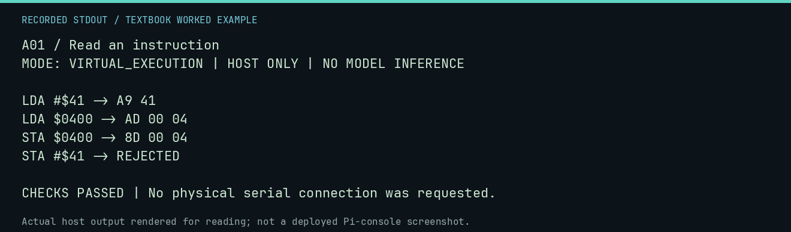

# A01 worked lab: Read an instruction

[Lesson](README.md) · [Activity](ACTIVITY.md) · [Answers](ANSWERS.md) · [Source notes](SOURCE-NOTES.md)

**Goal:** Read mnemonic, addressing mode, and operand.

**Mode:** `VIRTUAL_EXECUTION`. This companion runs on the host; it does not
change the original packet's paper activity or authorize physical Replica work.

## Understand the example

The # character means an immediate value. Without it, LDA $0400 loads the byte stored at that address. The assembler turns the instruction into bytes; neither mnemonic text nor a label is sent directly to the CPU.

## Predict before running

Read the source below. Write down the expected printed values and the condition
that would make its checks fail. For a CPU trace, distinguish state before an
instruction from state after it. For a conceptual exercise, explain the rule
behind each classification rather than memorizing the printed label.

## Run it

From the checkout root with your environment active:

```bash
python -m tools.textbook run A01
```

The runner executes this [complete source](../../textbook/examples/A01.py):

```python
from neural1.assembler import LessonAssembler

for source in ("LDA #$41", "LDA $0400", "STA $0400", "STA #$41"):
    r = LessonAssembler().assemble(source, origin=0x300)
    print(source, "->", "REJECTED" if r.diagnostics else r.payload.hex(" ").upper())
assert LessonAssembler().assemble("STA #$41").diagnostics
```

## Recorded result

This output was actually executed and checked. The image is a readable render
of that stdout, not a screenshot of the deployed Pi console. A teaching fixture
or a host analogue is not independent historical or physical evidence.

```text
A01 / Read an instruction
MODE: VIRTUAL_EXECUTION | HOST ONLY | NO MODEL INFERENCE

LDA #$41 -> A9 41
LDA $0400 -> AD 00 04
STA $0400 -> 8D 00 04
STA #$41 -> REJECTED

CHECKS PASSED | No physical serial connection was requested.
```



[Raw output](../../textbook/captures/A01.txt) · [Capture manifest](../../textbook/captures/manifest.json)

## Change one thing

Why is STA #$41 invalid?

<details>
<summary>Compare your reasoning with the worked answer</summary>

STA needs a destination address; an immediate literal is a value, not a writable destination.

</details>

## Check your understanding

Explain the result without reading the code aloud. Name one condition that the
example did not test. Keep your prediction, changed input, actual output, and
interpretation together in your lab notebook. Use the linked textbook chapter
and the original source records for the broader context and evidence limits.

[Textbook home](../../textbook/README.md) · Previous: [M05: Why `JMP $FF1F` matters](../M05-why-jmp-ff1f-matters/WORKED.md) · Next: [A02: Variables in memory](../A02-variables-in-memory/WORKED.md)
