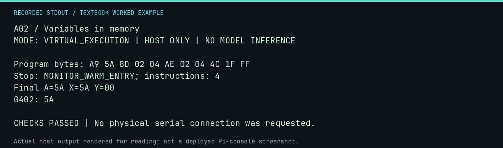

# A02 worked lab: Variables in memory

[Lesson](README.md) · [Activity](ACTIVITY.md) · [Answers](ANSWERS.md) · [Source notes](SOURCE-NOTES.md)

**Goal:** Store and retrieve a variable.

**Mode:** `VIRTUAL_EXECUTION`. This companion runs on the host; it does not
change the original packet's paper activity or authorize physical Replica work.

## Understand the example

A variable label is a source-code name for storage. The CPU uses numeric addresses. After storing $5A at $0402, loading from that address into X must produce the same value unless intervening code changes it.

## Predict before running

Read the source below. Write down the expected printed values and the condition
that would make its checks fail. For a CPU trace, distinguish state before an
instruction from state after it. For a conceptual exercise, explain the rule
behind each classification rather than memorizing the printed label.

## Run it

From the checkout root with your environment active:

```bash
python -m tools.textbook run A02
```

The runner executes this [complete source](../../textbook/examples/A02.py):

```python
from tools.textbook_support import cpu

w, r, a = cpu("LDA #$5A\nSTA $0402\nLDX $0402\nJMP $FF1F", inspect=(0x402,))
assert r.final_x == 0x5A and w.host_read(0x402) == b"Z"
```

## Recorded result

This output was actually executed and checked. The image is a readable render
of that stdout, not a screenshot of the deployed Pi console. A teaching fixture
or a host analogue is not independent historical or physical evidence.

```text
A02 / Variables in memory
MODE: VIRTUAL_EXECUTION | HOST ONLY | NO MODEL INFERENCE

Program bytes: A9 5A 8D 02 04 AE 02 04 4C 1F FF
Stop: MONITOR_WARM_ENTRY; instructions: 4
Final A=5A X=5A Y=00
0402: 5A

CHECKS PASSED | No physical serial connection was requested.
```



[Raw output](../../textbook/captures/A02.txt) · [Capture manifest](../../textbook/captures/manifest.json)

## Change one thing

If the program occupies $0300-$0319, why is $0310 a poor buffer?

<details>
<summary>Compare your reasoning with the worked answer</summary>

It overlaps instruction bytes. An input store could change a future instruction.

</details>

## Check your understanding

Explain the result without reading the code aloud. Name one condition that the
example did not test. Keep your prediction, changed input, actual output, and
interpretation together in your lab notebook. Use the linked textbook chapter
and the original source records for the broader context and evidence limits.

[Textbook home](../../textbook/README.md) · Previous: [A01: Read an instruction](../A01-read-an-instruction/WORKED.md) · Next: [A03: Counting and looping](../A03-counting-and-looping/WORKED.md)
