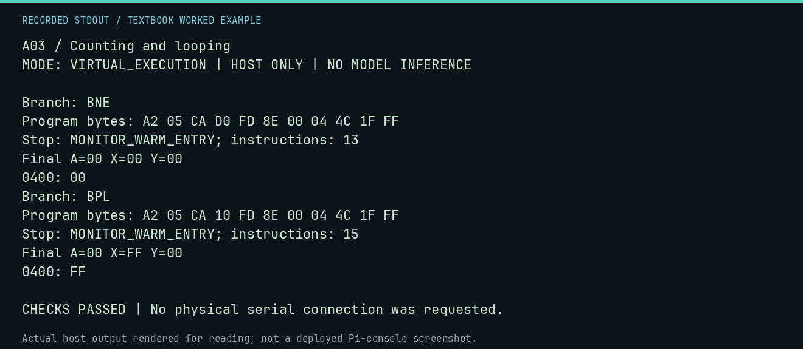

# A03 worked lab: Counting and looping

[Lesson](README.md) · [Activity](ACTIVITY.md) · [Answers](ANSWERS.md) · [Source notes](SOURCE-NOTES.md)

**Goal:** Compare zero and sign loop conditions.

**Mode:** `VIRTUAL_EXECUTION`. This companion runs on the host; it does not
change the original packet's paper activity or authorize physical Replica work.

## Understand the example

DEX changes X and the zero and negative flags. BNE repeats until zero. BPL repeats while bit 7 is clear, which includes zero. Starting at five, the BPL version therefore decrements once more and finishes at $FF.

## Predict before running

Read the source below. Write down the expected printed values and the condition
that would make its checks fail. For a CPU trace, distinguish state before an
instruction from state after it. For a conceptual exercise, explain the rule
behind each classification rather than memorizing the printed label.

## Run it

From the checkout root with your environment active:

```bash
python -m tools.textbook run A03
```

The runner executes this [complete source](../../textbook/examples/A03.py):

```python
from tools.textbook_support import cpu

for branch, expected in [("BNE", 0), ("BPL", 255)]:
    print("Branch:", branch)
    w, r, a = cpu(f"LDX #$05\nLOOP: DEX\n{branch} LOOP\nSTX $0400\nJMP $FF1F")
    assert r.final_x == expected
```

## Recorded result

This output was actually executed and checked. The image is a readable render
of that stdout, not a screenshot of the deployed Pi console. A teaching fixture
or a host analogue is not independent historical or physical evidence.

```text
A03 / Counting and looping
MODE: VIRTUAL_EXECUTION | HOST ONLY | NO MODEL INFERENCE

Branch: BNE
Program bytes: A2 05 CA D0 FD 8E 00 04 4C 1F FF
Stop: MONITOR_WARM_ENTRY; instructions: 13
Final A=00 X=00 Y=00
0400: 00
Branch: BPL
Program bytes: A2 05 CA 10 FD 8E 00 04 4C 1F FF
Stop: MONITOR_WARM_ENTRY; instructions: 15
Final A=00 X=FF Y=00
0400: FF

CHECKS PASSED | No physical serial connection was requested.
```



[Raw output](../../textbook/captures/A03.txt) · [Capture manifest](../../textbook/captures/manifest.json)

## Change one thing

What happens if the BNE countdown starts at zero?

<details>
<summary>Compare your reasoning with the worked answer</summary>

The first DEX wraps to $FF; it takes 256 decrements to reach zero again.

</details>

## Check your understanding

Explain the result without reading the code aloud. Name one condition that the
example did not test. Keep your prediction, changed input, actual output, and
interpretation together in your lab notebook. Use the linked textbook chapter
and the original source records for the broader context and evidence limits.

[Textbook home](../../textbook/README.md) · Previous: [A02: Variables in memory](../A02-variables-in-memory/WORKED.md) · Next: [A04: Decisions and branches](../A04-decisions-and-branches/WORKED.md)
