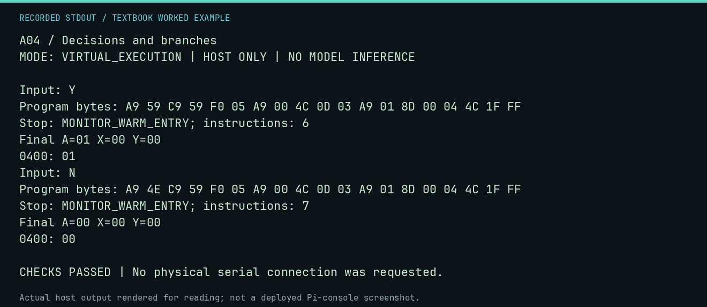

# A04 worked lab: Decisions and branches

[Lesson](README.md) · [Activity](ACTIVITY.md) · [Answers](ANSWERS.md) · [Source notes](SOURCE-NOTES.md)

**Goal:** Test both sides of a branch.

**Mode:** `VIRTUAL_EXECUTION`. This companion runs on the host; it does not
change the original packet's paper activity or authorize physical Replica work.

## Understand the example

CMP sets flags without replacing A. BEQ takes the equal case; the other path must not fall through into it accidentally. These two runs exercise the same decision with matching and nonmatching inputs.

## Predict before running

Read the source below. Write down the expected printed values and the condition
that would make its checks fail. For a CPU trace, distinguish state before an
instruction from state after it. For a conceptual exercise, explain the rule
behind each classification rather than memorizing the printed label.

## Run it

From the checkout root with your environment active:

```bash
python -m tools.textbook run A04
```

The runner executes this [complete source](../../textbook/examples/A04.py):

```python
from tools.textbook_support import cpu

for key, expected in [(0x59, 1), (0x4E, 0)]:
    print("Input:", chr(key))
    w, r, a = cpu(f"LDA #${key:02X}\nCMP #$59\nBEQ YES\nLDA #$00\nJMP SAVE\nYES: LDA #$01\nSAVE: STA $0400\nJMP $FF1F")
    assert w.host_read(0x400)[0] == expected
```

## Recorded result

This output was actually executed and checked. The image is a readable render
of that stdout, not a screenshot of the deployed Pi console. A teaching fixture
or a host analogue is not independent historical or physical evidence.

```text
A04 / Decisions and branches
MODE: VIRTUAL_EXECUTION | HOST ONLY | NO MODEL INFERENCE

Input: Y
Program bytes: A9 59 C9 59 F0 05 A9 00 4C 0D 03 A9 01 8D 00 04 4C 1F FF
Stop: MONITOR_WARM_ENTRY; instructions: 6
Final A=01 X=00 Y=00
0400: 01
Input: N
Program bytes: A9 4E C9 59 F0 05 A9 00 4C 0D 03 A9 01 8D 00 04 4C 1F FF
Stop: MONITOR_WARM_ENTRY; instructions: 7
Final A=00 X=00 Y=00
0400: 00

CHECKS PASSED | No physical serial connection was requested.
```



[Raw output](../../textbook/captures/A04.txt) · [Capture manifest](../../textbook/captures/manifest.json)

## Change one thing

Would testing only Y reveal a broken non-Y path?

<details>
<summary>Compare your reasoning with the worked answer</summary>

No. Include a matching key, a nonmatching key, and boundary or malformed inputs when relevant.

</details>

## Check your understanding

Explain the result without reading the code aloud. Name one condition that the
example did not test. Keep your prediction, changed input, actual output, and
interpretation together in your lab notebook. Use the linked textbook chapter
and the original source records for the broader context and evidence limits.

[Textbook home](../../textbook/README.md) · Previous: [A03: Counting and looping](../A03-counting-and-looping/WORKED.md) · Next: [A05: Keyboard to screen](../A05-keyboard-to-screen/WORKED.md)
