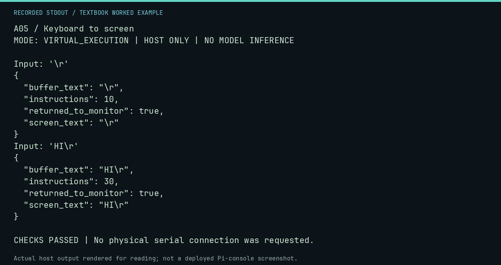

# A05 worked lab: Keyboard to screen

[Lesson](README.md) · [Activity](ACTIVITY.md) · [Answers](ANSWERS.md) · [Source notes](SOURCE-NOTES.md)

**Goal:** Follow input, buffer storage, echo, and return.

**Mode:** `VIRTUAL_EXECUTION`. This companion runs on the host; it does not
change the original packet's paper activity or authorize physical Replica work.

## Understand the example

The existing RAM program waits for a ready key, reads it, stores it at the indexed buffer position, echoes it, compares against carriage return, and either continues or exits. Empty input is a separate test: Return itself is still a character.

## Predict before running

Read the source below. Write down the expected printed values and the condition
that would make its checks fail. For a CPU trace, distinguish state before an
instruction from state after it. For a conceptual exercise, explain the rule
behind each classification rather than memorizing the printed label.

## Run it

From the checkout root with your environment active:

```bash
python -m tools.textbook run A05
```

The runner executes this [complete source](../../textbook/examples/A05.py):

```python
from tools.textbook_support import echo

for text in ("\r", "HI\r"):
    print("Input:", repr(text))
    r = echo(text)
    assert r.buffer_text == r.screen_text == text and r.returned_to_monitor
```

## Recorded result

This output was actually executed and checked. The image is a readable render
of that stdout, not a screenshot of the deployed Pi console. A teaching fixture
or a host analogue is not independent historical or physical evidence.

```text
A05 / Keyboard to screen
MODE: VIRTUAL_EXECUTION | HOST ONLY | NO MODEL INFERENCE

Input: '\r'
{
  "buffer_text": "\r",
  "instructions": 10,
  "returned_to_monitor": true,
  "screen_text": "\r"
}
Input: 'HI\r'
{
  "buffer_text": "HI\r",
  "instructions": 30,
  "returned_to_monitor": true,
  "screen_text": "HI\r"
}

CHECKS PASSED | No physical serial connection was requested.
```



[Raw output](../../textbook/captures/A05.txt) · [Capture manifest](../../textbook/captures/manifest.json)

## Change one thing

Why does the saved buffer include carriage return?

<details>
<summary>Compare your reasoning with the worked answer</summary>

The store happens before the carriage-return comparison and exit.

</details>

## Check your understanding

Explain the result without reading the code aloud. Name one condition that the
example did not test. Keep your prediction, changed input, actual output, and
interpretation together in your lab notebook. Use the linked textbook chapter
and the original source records for the broader context and evidence limits.

[Textbook home](../../textbook/README.md) · Previous: [A04: Decisions and branches](../A04-decisions-and-branches/WORKED.md) · Next: [A06: Design a tiny utility](../A06-design-a-tiny-utility/WORKED.md)
