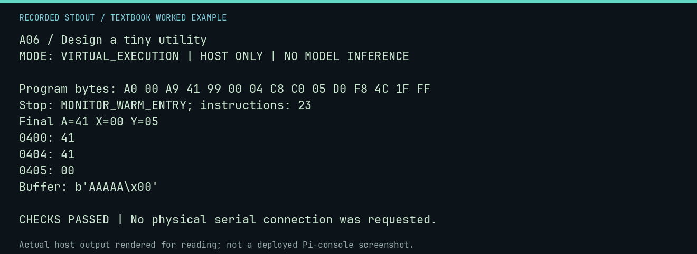

# A06 worked lab: Design a tiny utility

[Lesson](README.md) · [Activity](ACTIVITY.md) · [Answers](ANSWERS.md) · [Source notes](SOURCE-NOTES.md)

**Goal:** Build a fill utility from a testable design.

**Mode:** `VIRTUAL_EXECUTION`. This companion runs on the host; it does not
change the original packet's paper activity or authorize physical Replica work.

## Understand the example

Define the count and the allowed destination range before writing instructions. This routine fills exactly five bytes with A and exits. Checking the byte just after the range catches an extra iteration.

## Predict before running

Read the source below. Write down the expected printed values and the condition
that would make its checks fail. For a CPU trace, distinguish state before an
instruction from state after it. For a conceptual exercise, explain the rule
behind each classification rather than memorizing the printed label.

## Run it

From the checkout root with your environment active:

```bash
python -m tools.textbook run A06
```

The runner executes this [complete source](../../textbook/examples/A06.py):

```python
from tools.textbook_support import cpu

w, r, a = cpu("LDY #$00\nLDA #$41\nFILL: STA $0400,Y\nINY\nCPY #$05\nBNE FILL\nJMP $FF1F", inspect=(0x400, 0x404, 0x405))
print("Buffer:", repr(w.host_read(0x400, 6)))
assert w.host_read(0x400, 6) == b"AAAAA\x00"
```

## Recorded result

This output was actually executed and checked. The image is a readable render
of that stdout, not a screenshot of the deployed Pi console. A teaching fixture
or a host analogue is not independent historical or physical evidence.

```text
A06 / Design a tiny utility
MODE: VIRTUAL_EXECUTION | HOST ONLY | NO MODEL INFERENCE

Program bytes: A0 00 A9 41 99 00 04 C8 C0 05 D0 F8 4C 1F FF
Stop: MONITOR_WARM_ENTRY; instructions: 23
Final A=41 X=00 Y=05
0400: 41
0404: 41
0405: 00
Buffer: b'AAAAA\x00'

CHECKS PASSED | No physical serial connection was requested.
```



[Raw output](../../textbook/captures/A06.txt) · [Capture manifest](../../textbook/captures/manifest.json)

## Change one thing

Make a copy utility instead. What additional cases should its design card include?

<details>
<summary>Compare your reasoning with the worked answer</summary>

Zero length, maximum length, overlapping source/destination, and preserving the source when required.

</details>

## Check your understanding

Explain the result without reading the code aloud. Name one condition that the
example did not test. Keep your prediction, changed input, actual output, and
interpretation together in your lab notebook. Use the linked textbook chapter
and the original source records for the broader context and evidence limits.

[Textbook home](../../textbook/README.md) · Previous: [A05: Keyboard to screen](../A05-keyboard-to-screen/WORKED.md) · Next: [B01: From instructions to BASIC](../B01-from-instructions-to-basic/WORKED.md)
