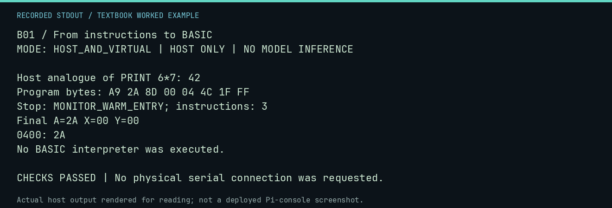

# B01 worked lab: From instructions to BASIC

[Lesson](README.md) · [Activity](ACTIVITY.md) · [Answers](ANSWERS.md) · [Source notes](SOURCE-NOTES.md)

**Goal:** Compare language levels without inventing a BASIC runtime.

**Mode:** `HOST_AND_VIRTUAL`. This companion runs on the host; it does not
change the original packet's paper activity or authorize physical Replica work.

## Understand the example

A BASIC expression delegates arithmetic and output to an interpreter. Assembly exposes the storage and instructions. This host calculation checks the arithmetic idea only: the repository does not bundle a runnable Apple-1 BASIC interpreter for this exercise.

## Predict before running

Read the source below. Write down the expected printed values and the condition
that would make its checks fail. For a CPU trace, distinguish state before an
instruction from state after it. For a conceptual exercise, explain the rule
behind each classification rather than memorizing the printed label.

## Run it

From the checkout root with your environment active:

```bash
python -m tools.textbook run B01
```

The runner executes this [complete source](../../textbook/examples/B01.py):

```python
from tools.textbook_support import cpu

print("Host analogue of PRINT 6*7:", 6 * 7)
w, r, a = cpu("LDA #$2A\nSTA $0400\nJMP $FF1F")
assert w.host_read(0x400)[0] == 6 * 7
print("No BASIC interpreter was executed.")
```

## Recorded result

This output was actually executed and checked. The image is a readable render
of that stdout, not a screenshot of the deployed Pi console. A teaching fixture
or a host analogue is not independent historical or physical evidence.

```text
B01 / From instructions to BASIC
MODE: HOST_AND_VIRTUAL | HOST ONLY | NO MODEL INFERENCE

Host analogue of PRINT 6*7: 42
Program bytes: A9 2A 8D 00 04 4C 1F FF
Stop: MONITOR_WARM_ENTRY; instructions: 3
Final A=2A X=00 Y=00
0400: 2A
No BASIC interpreter was executed.

CHECKS PASSED | No physical serial connection was requested.
```



[Raw output](../../textbook/captures/B01.txt) · [Capture manifest](../../textbook/captures/manifest.json)

## Change one thing

Does storing the answer 42 implement multiplication?

<details>
<summary>Compare your reasoning with the worked answer</summary>

No. It demonstrates representing one result; a general multiply routine or interpreter performs the operation.

</details>

## Check your understanding

Explain the result without reading the code aloud. Name one condition that the
example did not test. Keep your prediction, changed input, actual output, and
interpretation together in your lab notebook. Use the linked textbook chapter
and the original source records for the broader context and evidence limits.

[Textbook home](../../textbook/README.md) · Previous: [A06: Design a tiny utility](../A06-design-a-tiny-utility/WORKED.md) · Next: [B02: Variables, input, and output](../B02-variables-input-and-output/WORKED.md)
