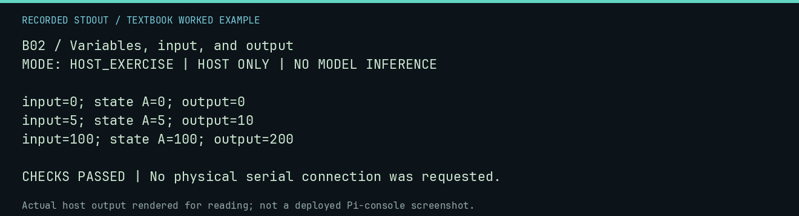

# B02 worked lab: Variables, input, and output

[Lesson](README.md) · [Activity](ACTIVITY.md) · [Answers](ANSWERS.md) · [Source notes](SOURCE-NOTES.md)

**Goal:** Separate input, state, computation, and output.

**Mode:** `HOST_EXERCISE`. This companion runs on the host; it does not
change the original packet's paper activity or authorize physical Replica work.

## Understand the example

A small program has a data path. Here the input is an integer and the output is twice it. This Python host analogue illustrates the flow; it does not validate Apple-1 BASIC syntax or string allocation rules.

## Predict before running

Read the source below. Write down the expected printed values and the condition
that would make its checks fail. For a CPU trace, distinguish state before an
instruction from state after it. For a conceptual exercise, explain the rule
behind each classification rather than memorizing the printed label.

## Run it

From the checkout root with your environment active:

```bash
python -m tools.textbook run B02
```

The runner executes this [complete source](../../textbook/examples/B02.py):

```python
for input_value in (0, 5, 100):
    output_value = input_value * 2
    print(f"input={input_value}; state A={input_value}; output={output_value}")
    assert output_value == input_value + input_value
```

## Recorded result

This output was actually executed and checked. The image is a readable render
of that stdout, not a screenshot of the deployed Pi console. A teaching fixture
or a host analogue is not independent historical or physical evidence.

```text
B02 / Variables, input, and output
MODE: HOST_EXERCISE | HOST ONLY | NO MODEL INFERENCE

input=0; state A=0; output=0
input=5; state A=5; output=10
input=100; state A=100; output=200

CHECKS PASSED | No physical serial connection was requested.
```



[Raw output](../../textbook/captures/B02.txt) · [Capture manifest](../../textbook/captures/manifest.json)

## Change one thing

What would you specify before accepting negative or fractional input?

<details>
<summary>Compare your reasoning with the worked answer</summary>

The numeric domain, conversion rules, errors, and representation. Apple-1 Integer BASIC is not interchangeable with Python numeric behavior.

</details>

## Check your understanding

Explain the result without reading the code aloud. Name one condition that the
example did not test. Keep your prediction, changed input, actual output, and
interpretation together in your lab notebook. Use the linked textbook chapter
and the original source records for the broader context and evidence limits.

[Textbook home](../../textbook/README.md) · Previous: [B01: From instructions to BASIC](../B01-from-instructions-to-basic/WORKED.md) · Next: [B03: Algorithms: recipes for information](../B03-algorithms-recipes-for-information/WORKED.md)
