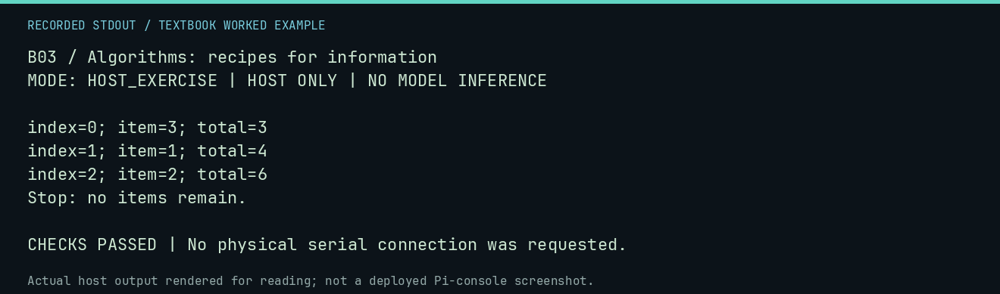

# B03 worked lab: Algorithms: recipes for information

[Lesson](README.md) · [Activity](ACTIVITY.md) · [Answers](ANSWERS.md) · [Source notes](SOURCE-NOTES.md)

**Goal:** Turn an ambiguous algorithm into explicit operations.

**Mode:** `HOST_EXERCISE`. This companion runs on the host; it does not
change the original packet's paper activity or authorize physical Replica work.

## Understand the example

An algorithm states how the next step is chosen and when work stops. The host trace below replaces "add the numbers" with initialize, read one item, update, and stop at the end of the finite list.

## Predict before running

Read the source below. Write down the expected printed values and the condition
that would make its checks fail. For a CPU trace, distinguish state before an
instruction from state after it. For a conceptual exercise, explain the rule
behind each classification rather than memorizing the printed label.

## Run it

From the checkout root with your environment active:

```bash
python -m tools.textbook run B03
```

The runner executes this [complete source](../../textbook/examples/B03.py):

```python
items = [3, 1, 2]
total = 0
for index, item in enumerate(items):
    total += item
    print(f"index={index}; item={item}; total={total}")
assert total == 6
print("Stop: no items remain.")
```

## Recorded result

This output was actually executed and checked. The image is a readable render
of that stdout, not a screenshot of the deployed Pi console. A teaching fixture
or a host analogue is not independent historical or physical evidence.

```text
B03 / Algorithms: recipes for information
MODE: HOST_EXERCISE | HOST ONLY | NO MODEL INFERENCE

index=0; item=3; total=3
index=1; item=1; total=4
index=2; item=2; total=6
Stop: no items remain.

CHECKS PASSED | No physical serial connection was requested.
```



[Raw output](../../textbook/captures/B03.txt) · [Capture manifest](../../textbook/captures/manifest.json)

## Change one thing

What result should the algorithm produce for an empty list?

<details>
<summary>Compare your reasoning with the worked answer</summary>

Zero if the sum specification defines an empty sum as zero; write that rule explicitly.

</details>

## Check your understanding

Explain the result without reading the code aloud. Name one condition that the
example did not test. Keep your prediction, changed input, actual output, and
interpretation together in your lab notebook. Use the linked textbook chapter
and the original source records for the broader context and evidence limits.

[Textbook home](../../textbook/README.md) · Previous: [B02: Variables, input, and output](../B02-variables-input-and-output/WORKED.md) · Next: [B04: Sorting by hand](../B04-sorting-by-hand/WORKED.md)
