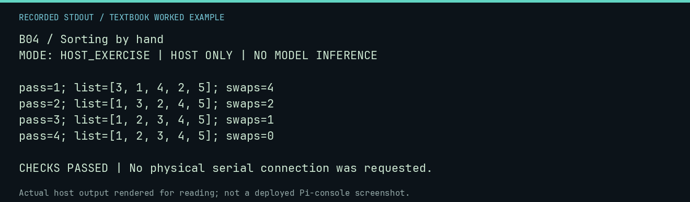

# B04 worked lab: Sorting by hand

[Lesson](README.md) · [Activity](ACTIVITY.md) · [Answers](ANSWERS.md) · [Source notes](SOURCE-NOTES.md)

**Goal:** Trace sorting instead of trusting the final list.

**Mode:** `HOST_EXERCISE`. This companion runs on the host; it does not
change the original packet's paper activity or authorize physical Replica work.

## Understand the example

Adjacent comparisons and swaps can sort a list. A pass with no swaps supplies a stopping condition. Save intermediate lists so a correct final result does not conceal a different algorithm or an incorrect comparison count.

## Predict before running

Read the source below. Write down the expected printed values and the condition
that would make its checks fail. For a CPU trace, distinguish state before an
instruction from state after it. For a conceptual exercise, explain the rule
behind each classification rather than memorizing the printed label.

## Run it

From the checkout root with your environment active:

```bash
python -m tools.textbook run B04
```

The runner executes this [complete source](../../textbook/examples/B04.py):

```python
items = [5, 3, 1, 4, 2]
passes = 0
while True:
    swaps = 0
    for i in range(len(items) - 1):
        if items[i] > items[i + 1]:
            items[i], items[i + 1] = items[i + 1], items[i]
            swaps += 1
    passes += 1
    print(f"pass={passes}; list={items}; swaps={swaps}")
    if swaps == 0:
        break
assert items == [1, 2, 3, 4, 5]
```

## Recorded result

This output was actually executed and checked. The image is a readable render
of that stdout, not a screenshot of the deployed Pi console. A teaching fixture
or a host analogue is not independent historical or physical evidence.

```text
B04 / Sorting by hand
MODE: HOST_EXERCISE | HOST ONLY | NO MODEL INFERENCE

pass=1; list=[3, 1, 4, 2, 5]; swaps=4
pass=2; list=[1, 3, 2, 4, 5]; swaps=2
pass=3; list=[1, 2, 3, 4, 5]; swaps=1
pass=4; list=[1, 2, 3, 4, 5]; swaps=0

CHECKS PASSED | No physical serial connection was requested.
```



[Raw output](../../textbook/captures/B04.txt) · [Capture manifest](../../textbook/captures/manifest.json)

## Change one thing

Why retain the final no-swap pass?

<details>
<summary>Compare your reasoning with the worked answer</summary>

It is the evidence used by this version of the algorithm to stop; it still performs comparisons.

</details>

## Check your understanding

Explain the result without reading the code aloud. Name one condition that the
example did not test. Keep your prediction, changed input, actual output, and
interpretation together in your lab notebook. Use the linked textbook chapter
and the original source records for the broader context and evidence limits.

[Textbook home](../../textbook/README.md) · Previous: [B03: Algorithms: recipes for information](../B03-algorithms-recipes-for-information/WORKED.md) · Next: [B05: Data, files, and the CF card](../B05-data-files-and-the-cf-card/WORKED.md)
