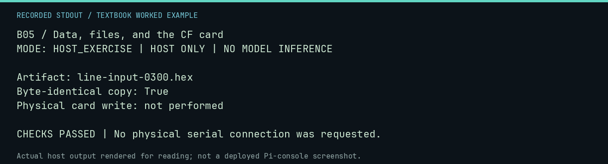

# B05 worked lab: Data, files, and the CF card

[Lesson](README.md) · [Activity](ACTIVITY.md) · [Answers](ANSWERS.md) · [Source notes](SOURCE-NOTES.md)

**Goal:** Separate a source artifact, a record, and a backup.

**Mode:** `HOST_EXERCISE`. This companion runs on the host; it does not
change the original packet's paper activity or authorize physical Replica work.

## Understand the example

A filename extension does not establish a role or execution authority. A content hash can show that a copied byte sequence matches. It does not establish that a file is suitable for a card layout or a physical launcher.

## Predict before running

Read the source below. Write down the expected printed values and the condition
that would make its checks fail. For a CPU trace, distinguish state before an
instruction from state after it. For a conceptual exercise, explain the rule
behind each classification rather than memorizing the printed label.

## Run it

From the checkout root with your environment active:

```bash
python -m tools.textbook run B05
```

The runner executes this [complete source](../../textbook/examples/B05.py):

```python
from hashlib import sha256

from tools.textbook_support import ROOT

p = ROOT / "software/ram-only/line-input-0300.hex"
original = p.read_bytes()
copy = bytes(original)
print("Artifact:", p.name)
print("Byte-identical copy:", sha256(original).digest() == sha256(copy).digest())
print("Physical card write: not performed")
assert original == copy
```

## Recorded result

This output was actually executed and checked. The image is a readable render
of that stdout, not a screenshot of the deployed Pi console. A teaching fixture
or a host analogue is not independent historical or physical evidence.

```text
B05 / Data, files, and the CF card
MODE: HOST_EXERCISE | HOST ONLY | NO MODEL INFERENCE

Artifact: line-input-0300.hex
Byte-identical copy: True
Physical card write: not performed

CHECKS PASSED | No physical serial connection was requested.
```



[Raw output](../../textbook/captures/B05.txt) · [Capture manifest](../../textbook/captures/manifest.json)

## Change one thing

Does committing a .hex file make it CF-card approved?

<details>
<summary>Compare your reasoning with the worked answer</summary>

No. Manifest approval, layout validation, and physical deployment are separate steps.

</details>

## Check your understanding

Explain the result without reading the code aloud. Name one condition that the
example did not test. Keep your prediction, changed input, actual output, and
interpretation together in your lab notebook. Use the linked textbook chapter
and the original source records for the broader context and evidence limits.

[Textbook home](../../textbook/README.md) · Previous: [B04: Sorting by hand](../B04-sorting-by-hand/WORKED.md) · Next: [R01: Pictures made of letters](../R01-pictures-made-of-letters/WORKED.md)
