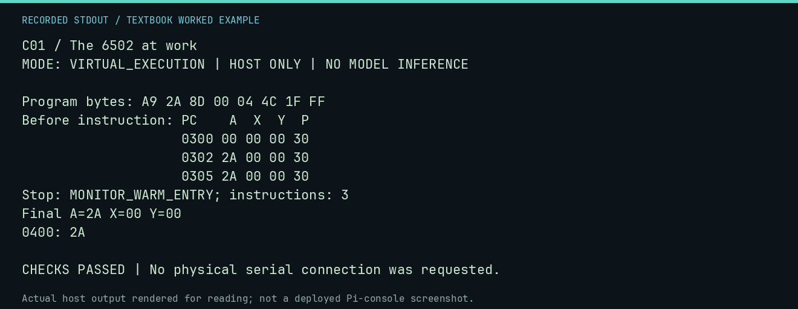

# C01 worked lab: The 6502 at work

[Lesson](README.md) · [Activity](ACTIVITY.md) · [Answers](ANSWERS.md) · [Source notes](SOURCE-NOTES.md)

**Goal:** Follow fetch, decode, execute.

**Mode:** `VIRTUAL_EXECUTION`. This companion runs on the host; it does not
change the original packet's paper activity or authorize physical Replica work.

## Understand the example

LDA immediate loads a value into A; STA copies A into memory; JMP chooses the next instruction address. The trace records state before each instruction. Read the next row, or the final registers, to see the effect.

## Predict before running

Read the source below. Write down the expected printed values and the condition
that would make its checks fail. For a CPU trace, distinguish state before an
instruction from state after it. For a conceptual exercise, explain the rule
behind each classification rather than memorizing the printed label.

## Run it

From the checkout root with your environment active:

```bash
python -m tools.textbook run C01
```

The runner executes this [complete source](../../textbook/examples/C01.py):

```python
from tools.textbook_support import cpu

w, r, a = cpu("LDA #$2A\nSTA $0400\nJMP $FF1F", trace=True)
assert w.host_read(0x400) == b"\x2a"
assert r.stop_reason == "MONITOR_WARM_ENTRY"
```

## Recorded result

This output was actually executed and checked. The image is a readable render
of that stdout, not a screenshot of the deployed Pi console. A teaching fixture
or a host analogue is not independent historical or physical evidence.

```text
C01 / The 6502 at work
MODE: VIRTUAL_EXECUTION | HOST ONLY | NO MODEL INFERENCE

Program bytes: A9 2A 8D 00 04 4C 1F FF
Before instruction: PC    A  X  Y  P
                    0300 00 00 00 30
                    0302 2A 00 00 30
                    0305 2A 00 00 30
Stop: MONITOR_WARM_ENTRY; instructions: 3
Final A=2A X=00 Y=00
0400: 2A

CHECKS PASSED | No physical serial connection was requested.
```



[Raw output](../../textbook/captures/C01.txt) · [Capture manifest](../../textbook/captures/manifest.json)

## Change one thing

Replace $2A with $10. Predict memory and the program byte that changes.

<details>
<summary>Compare your reasoning with the worked answer</summary>

The immediate operand changes from 2A to 10, and $0400 contains $10 (16).

</details>

## Check your understanding

Explain the result without reading the code aloud. Name one condition that the
example did not test. Keep your prediction, changed input, actual output, and
interpretation together in your lab notebook. Use the linked textbook chapter
and the original source records for the broader context and evidence limits.

[Textbook home](../../textbook/README.md) · Previous: [S04: Facts, models, and evidence](../S04-facts-models-and-evidence/WORKED.md) · Next: [C02: Memory is a map](../C02-memory-is-a-map/WORKED.md)
