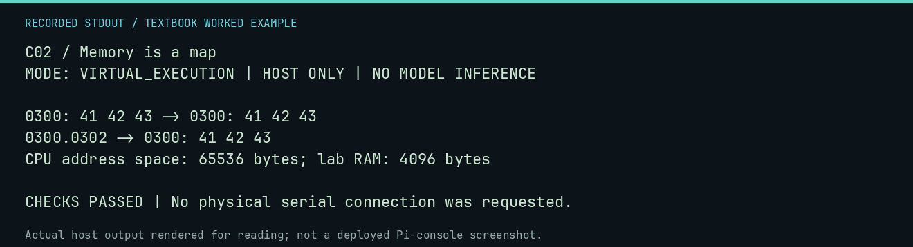

# C02 worked lab: Memory is a map

[Lesson](README.md) · [Activity](ACTIVITY.md) · [Answers](ANSWERS.md) · [Source notes](SOURCE-NOTES.md)

**Goal:** Addresses name locations; bytes hold values.

**Mode:** `VIRTUAL_EXECUTION`. This companion runs on the host; it does not
change the original packet's paper activity or authorize physical Replica work.

## Understand the example

A 16-bit address identifies one of 65,536 locations. The same byte can be data or an opcode depending on how it is used. These virtual locations are inside the declared lab RAM window; this is not the physical Replica memory map.

## Predict before running

Read the source below. Write down the expected printed values and the condition
that would make its checks fail. For a CPU trace, distinguish state before an
instruction from state after it. For a conceptual exercise, explain the rule
behind each classification rather than memorizing the printed label.

## Run it

From the checkout root with your environment active:

```bash
python -m tools.textbook run C02
```

The runner executes this [complete source](../../textbook/examples/C02.py):

```python
from neural1.world import VirtualApple1World, WozMonSession

w = VirtualApple1World()
m = WozMonSession(w)
for command in ("0300: 41 42 43", "0300.0302"):
    print(command, "->", m.transact(command))
assert w.host_read(0x300, 3) == b"ABC"
print("CPU address space:", 2**16, "bytes; lab RAM:", w.ram_budget, "bytes")
```

## Recorded result

This output was actually executed and checked. The image is a readable render
of that stdout, not a screenshot of the deployed Pi console. A teaching fixture
or a host analogue is not independent historical or physical evidence.

```text
C02 / Memory is a map
MODE: VIRTUAL_EXECUTION | HOST ONLY | NO MODEL INFERENCE

0300: 41 42 43 -> 0300: 41 42 43
0300.0302 -> 0300: 41 42 43
CPU address space: 65536 bytes; lab RAM: 4096 bytes

CHECKS PASSED | No physical serial connection was requested.
```



[Raw output](../../textbook/captures/C02.txt) · [Capture manifest](../../textbook/captures/manifest.json)

## Change one thing

What address follows $03FF?

<details>
<summary>Compare your reasoning with the worked answer</summary>

$0400. Carry crosses the low byte; it is not $040A.

</details>

## Check your understanding

Explain the result without reading the code aloud. Name one condition that the
example did not test. Keep your prediction, changed input, actual output, and
interpretation together in your lab notebook. Use the linked textbook chapter
and the original source records for the broader context and evidence limits.

[Textbook home](../../textbook/README.md) · Previous: [C01: The 6502 at work](../C01-the-6502-at-work/WORKED.md) · Next: [C03: Binary, bits, and bytes](../C03-binary-bits-and-bytes/WORKED.md)
