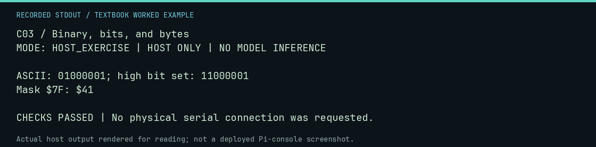

# C03 worked lab: Binary, bits, and bytes

[Lesson](README.md) · [Activity](ACTIVITY.md) · [Answers](ANSWERS.md) · [Source notes](SOURCE-NOTES.md)

**Goal:** Use masks to inspect bits.

**Mode:** `HOST_EXERCISE`. This companion runs on the host; it does not
change the original packet's paper activity or authorize physical Replica work.

## Understand the example

A mask selects bits. AND with $7F clears bit 7 while preserving the other seven bits; OR with $80 sets it. This is arithmetic on a byte, independent of whether the byte represents a character.

## Predict before running

Read the source below. Write down the expected printed values and the condition
that would make its checks fail. For a CPU trace, distinguish state before an
instruction from state after it. For a conceptual exercise, explain the rule
behind each classification rather than memorizing the printed label.

## Run it

From the checkout root with your environment active:

```bash
python -m tools.textbook run C03
```

The runner executes this [complete source](../../textbook/examples/C03.py):

```python
value = 0x41
encoded = value | 0x80
print(f"ASCII: {value:08b}; high bit set: {encoded:08b}")
print(f"Mask $7F: ${encoded & 0x7F:02X}")
assert encoded == 0xC1 and (encoded & 0x7F) == value
```

## Recorded result

This output was actually executed and checked. The image is a readable render
of that stdout, not a screenshot of the deployed Pi console. A teaching fixture
or a host analogue is not independent historical or physical evidence.

```text
C03 / Binary, bits, and bytes
MODE: HOST_EXERCISE | HOST ONLY | NO MODEL INFERENCE

ASCII: 01000001; high bit set: 11000001
Mask $7F: $41

CHECKS PASSED | No physical serial connection was requested.
```



[Raw output](../../textbook/captures/C03.txt) · [Capture manifest](../../textbook/captures/manifest.json)

## Change one thing

What does XOR $80 do if applied twice?

<details>
<summary>Compare your reasoning with the worked answer</summary>

It toggles bit 7 each time, so applying it twice restores the original byte.

</details>

## Check your understanding

Explain the result without reading the code aloud. Name one condition that the
example did not test. Keep your prediction, changed input, actual output, and
interpretation together in your lab notebook. Use the linked textbook chapter
and the original source records for the broader context and evidence limits.

[Textbook home](../../textbook/README.md) · Previous: [C02: Memory is a map](../C02-memory-is-a-map/WORKED.md) · Next: [C04: Characters become numbers](../C04-characters-become-numbers/WORKED.md)
