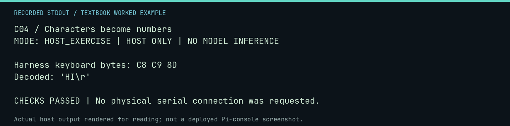

# C04 worked lab: Characters become numbers

[Lesson](README.md) · [Activity](ACTIVITY.md) · [Answers](ANSWERS.md) · [Source notes](SOURCE-NOTES.md)

**Goal:** Decode high-bit keyboard characters.

**Mode:** `HOST_EXERCISE`. This companion runs on the host; it does not
change the original packet's paper activity or authorize physical Replica work.

## Understand the example

The repository harness explicitly sets bit 7 on input and masks it for screen text. That convention must not be confused with ordinary seven-bit ASCII. Carriage return is $0D in ASCII and $8D with the high bit set.

## Predict before running

Read the source below. Write down the expected printed values and the condition
that would make its checks fail. For a CPU trace, distinguish state before an
instruction from state after it. For a conceptual exercise, explain the rule
behind each classification rather than memorizing the printed label.

## Run it

From the checkout root with your environment active:

```bash
python -m tools.textbook run C04
```

The runner executes this [complete source](../../textbook/examples/C04.py):

```python
raw = bytes(byte | 0x80 for byte in b"HI\r")
print("Harness keyboard bytes:", raw.hex(" ").upper())
decoded = bytes(byte & 0x7F for byte in raw)
print("Decoded:", repr(decoded.decode("ascii")))
assert raw == bytes.fromhex("C8 C9 8D") and decoded == b"HI\r"
```

## Recorded result

This output was actually executed and checked. The image is a readable render
of that stdout, not a screenshot of the deployed Pi console. A teaching fixture
or a host analogue is not independent historical or physical evidence.

```text
C04 / Characters become numbers
MODE: HOST_EXERCISE | HOST ONLY | NO MODEL INFERENCE

Harness keyboard bytes: C8 C9 8D
Decoded: 'HI\r'

CHECKS PASSED | No physical serial connection was requested.
```



[Raw output](../../textbook/captures/C04.txt) · [Capture manifest](../../textbook/captures/manifest.json)

## Change one thing

Decode C1 A0 C2 8D.

<details>
<summary>Compare your reasoning with the worked answer</summary>

A, space, B, carriage return: "A B\r".

</details>

## Check your understanding

Explain the result without reading the code aloud. Name one condition that the
example did not test. Keep your prediction, changed input, actual output, and
interpretation together in your lab notebook. Use the linked textbook chapter
and the original source records for the broader context and evidence limits.

[Textbook home](../../textbook/README.md) · Previous: [C03: Binary, bits, and bytes](../C03-binary-bits-and-bytes/WORKED.md) · Next: [C05: Instructions change state](../C05-instructions-change-state/WORKED.md)
