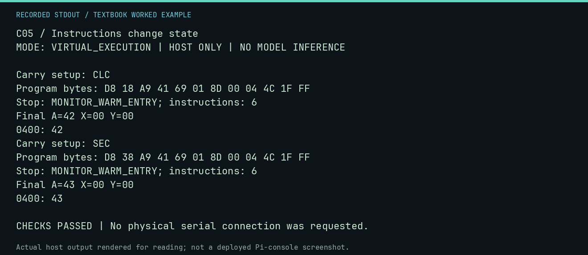

# C05 worked lab: Instructions change state

[Lesson](README.md) · [Activity](ACTIVITY.md) · [Answers](ANSWERS.md) · [Source notes](SOURCE-NOTES.md)

**Goal:** Initialize arithmetic state explicitly.

**Mode:** `VIRTUAL_EXECUTION`. This companion runs on the host; it does not
change the original packet's paper activity or authorize physical Replica work.

## Understand the example

ADC includes carry. CLD selects binary arithmetic and CLC clears carry before an addition. Relying on a simulator default makes a program harder to explain or move. The two runs below differ only in the explicit carry setup.

## Predict before running

Read the source below. Write down the expected printed values and the condition
that would make its checks fail. For a CPU trace, distinguish state before an
instruction from state after it. For a conceptual exercise, explain the rule
behind each classification rather than memorizing the printed label.

## Run it

From the checkout root with your environment active:

```bash
python -m tools.textbook run C05
```

The runner executes this [complete source](../../textbook/examples/C05.py):

```python
from tools.textbook_support import cpu

for flag, expected in [("CLC", 0x42), ("SEC", 0x43)]:
    print("Carry setup:", flag)
    w, r, a = cpu(f"CLD\n{flag}\nLDA #$41\nADC #$01\nSTA $0400\nJMP $FF1F")
    assert w.host_read(0x400)[0] == expected
```

## Recorded result

This output was actually executed and checked. The image is a readable render
of that stdout, not a screenshot of the deployed Pi console. A teaching fixture
or a host analogue is not independent historical or physical evidence.

```text
C05 / Instructions change state
MODE: VIRTUAL_EXECUTION | HOST ONLY | NO MODEL INFERENCE

Carry setup: CLC
Program bytes: D8 18 A9 41 69 01 8D 00 04 4C 1F FF
Stop: MONITOR_WARM_ENTRY; instructions: 6
Final A=42 X=00 Y=00
0400: 42
Carry setup: SEC
Program bytes: D8 38 A9 41 69 01 8D 00 04 4C 1F FF
Stop: MONITOR_WARM_ENTRY; instructions: 6
Final A=43 X=00 Y=00
0400: 43

CHECKS PASSED | No physical serial connection was requested.
```



[Raw output](../../textbook/captures/C05.txt) · [Capture manifest](../../textbook/captures/manifest.json)

## Change one thing

Why does CLC alone not establish binary arithmetic on an unknown machine state?

<details>
<summary>Compare your reasoning with the worked answer</summary>

The decimal flag is separate; use CLD when the program requires binary ADC behavior.

</details>

## Check your understanding

Explain the result without reading the code aloud. Name one condition that the
example did not test. Keep your prediction, changed input, actual output, and
interpretation together in your lab notebook. Use the linked textbook chapter
and the original source records for the broader context and evidence limits.

[Textbook home](../../textbook/README.md) · Previous: [C04: Characters become numbers](../C04-characters-become-numbers/WORKED.md) · Next: [M01: Meet the Monitor](../M01-meet-the-monitor/WORKED.md)
