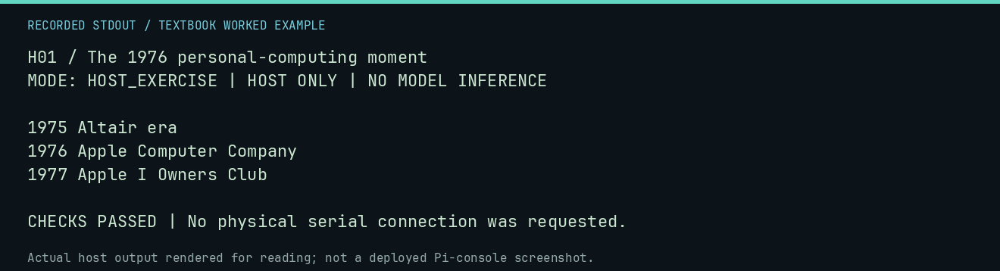

# H01 worked lab: The 1976 personal-computing moment

[Lesson](README.md) · [Activity](ACTIVITY.md) · [Answers](ANSWERS.md) · [Source notes](SOURCE-NOTES.md)

**Goal:** Order source-backed events without merging different counts.

**Mode:** `HOST_EXERCISE`. This companion runs on the host; it does not
change the original packet's paper activity or authorize physical Replica work.

## Understand the example

This exercise sorts an intentionally shuffled teaching timeline. The dates are drawn from the existing lesson source notes. Sorting them checks ordering logic; it is not independent verification of the underlying historical sources.

## Predict before running

Read the source below. Write down the expected printed values and the condition
that would make its checks fail. For a CPU trace, distinguish state before an
instruction from state after it. For a conceptual exercise, explain the rule
behind each classification rather than memorizing the printed label.

## Run it

From the checkout root with your environment active:

```bash
python -m tools.textbook run H01
```

The runner executes this [complete source](../../textbook/examples/H01.py):

```python
events = [(1977, "Apple I Owners Club"), (1976, "Apple Computer Company"), (1975, "Altair era")]
ordered = sorted(events)
for year, event in ordered:
    print(year, event)
assert [year for year, event in ordered] == [1975, 1976, 1977]
```

## Recorded result

This output was actually executed and checked. The image is a readable render
of that stdout, not a screenshot of the deployed Pi console. A teaching fixture
or a host analogue is not independent historical or physical evidence.

```text
H01 / The 1976 personal-computing moment
MODE: HOST_EXERCISE | HOST ONLY | NO MODEL INFERENCE

1975 Altair era
1976 Apple Computer Company
1977 Apple I Owners Club

CHECKS PASSED | No physical serial connection was requested.
```



[Raw output](../../textbook/captures/H01.txt) · [Capture manifest](../../textbook/captures/manifest.json)

## Change one thing

Why should "boards made" and "boards sold" be separate timeline facts?

<details>
<summary>Compare your reasoning with the worked answer</summary>

They count different events. One number cannot replace the other without evidence.

</details>

## Check your understanding

Explain the result without reading the code aloud. Name one condition that the
example did not test. Keep your prediction, changed input, actual output, and
interpretation together in your lab notebook. Use the linked textbook chapter
and the original source records for the broader context and evidence limits.

[Textbook home](../../textbook/README.md) · Previous: [R05: Sound, rhythm, and code](../R05-sound-rhythm-and-code/WORKED.md) · Next: [H02: Original, replica, and reproduction](../H02-original-replica-and-reproduction/WORKED.md)
