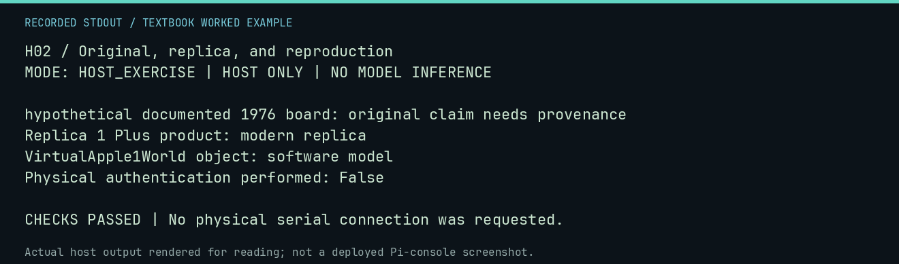

# H02 worked lab: Original, replica, and reproduction

[Lesson](README.md) · [Activity](ACTIVITY.md) · [Answers](ANSWERS.md) · [Source notes](SOURCE-NOTES.md)

**Goal:** Use object labels as bounded claims.

**Mode:** `HOST_EXERCISE`. This companion runs on the host; it does not
change the original packet's paper activity or authorize physical Replica work.

## Understand the example

The teaching labels below distinguish an original artifact, a modern replica, and a digital model. A label does not authenticate an actual object; it states the category whose evidence would need checking.

## Predict before running

Read the source below. Write down the expected printed values and the condition
that would make its checks fail. For a CPU trace, distinguish state before an
instruction from state after it. For a conceptual exercise, explain the rule
behind each classification rather than memorizing the printed label.

## Run it

From the checkout root with your environment active:

```bash
python -m tools.textbook run H02
```

The runner executes this [complete source](../../textbook/examples/H02.py):

```python
for item, category in [
    ("hypothetical documented 1976 board", "original claim needs provenance"),
    ("Replica 1 Plus product", "modern replica"),
    ("VirtualApple1World object", "software model"),
]:
    print(item + ": " + category)
print("Physical authentication performed: False")
```

## Recorded result

This output was actually executed and checked. The image is a readable render
of that stdout, not a screenshot of the deployed Pi console. A teaching fixture
or a host analogue is not independent historical or physical evidence.

```text
H02 / Original, replica, and reproduction
MODE: HOST_EXERCISE | HOST ONLY | NO MODEL INFERENCE

hypothetical documented 1976 board: original claim needs provenance
Replica 1 Plus product: modern replica
VirtualApple1World object: software model
Physical authentication performed: False

CHECKS PASSED | No physical serial connection was requested.
```



[Raw output](../../textbook/captures/H02.txt) · [Capture manifest](../../textbook/captures/manifest.json)

## Change one thing

Can a software model reproduce behavior without being a physical replica?

<details>
<summary>Compare your reasoning with the worked answer</summary>

Yes. Behavioral correspondence and physical object identity are different questions.

</details>

## Check your understanding

Explain the result without reading the code aloud. Name one condition that the
example did not test. Keep your prediction, changed input, actual output, and
interpretation together in your lab notebook. Use the linked textbook chapter
and the original source records for the broader context and evidence limits.

[Textbook home](../../textbook/README.md) · Previous: [H01: The 1976 personal-computing moment](../H01-the-1976-personal-computing-moment/WORKED.md) · Next: [H03: Why provenance matters](../H03-why-provenance-matters/WORKED.md)
