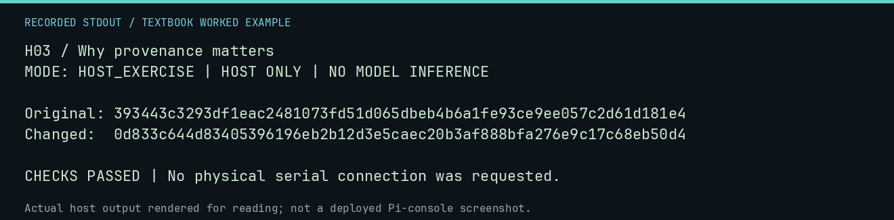

# H03 worked lab: Why provenance matters

[Lesson](README.md) · [Activity](ACTIVITY.md) · [Answers](ANSWERS.md) · [Source notes](SOURCE-NOTES.md)

**Goal:** Check identity with a cryptographic digest.

**Mode:** `HOST_EXERCISE`. This companion runs on the host; it does not
change the original packet's paper activity or authorize physical Replica work.

## Understand the example

SHA-256 detects a change to the bytes being hashed. It supplies a content identity, not the creator, date, license, or historical authenticity of that content. Compare the original and a changed copy.

## Predict before running

Read the source below. Write down the expected printed values and the condition
that would make its checks fail. For a CPU trace, distinguish state before an
instruction from state after it. For a conceptual exercise, explain the rule
behind each classification rather than memorizing the printed label.

## Run it

From the checkout root with your environment active:

```bash
python -m tools.textbook run H03
```

The runner executes this [complete source](../../textbook/examples/H03.py):

```python
from hashlib import sha256

original = b"RECORDED EXAMPLE\n"
changed = b"RECORDED EXAMPLE!\n"
print("Original:", sha256(original).hexdigest())
print("Changed: ", sha256(changed).hexdigest())
assert sha256(original).digest() != sha256(changed).digest()
```

## Recorded result

This output was actually executed and checked. The image is a readable render
of that stdout, not a screenshot of the deployed Pi console. A teaching fixture
or a host analogue is not independent historical or physical evidence.

```text
H03 / Why provenance matters
MODE: HOST_EXERCISE | HOST ONLY | NO MODEL INFERENCE

Original: 393443c3293df1eac2481073fd51d065dbeb4b6a1fe93ce9ee057c2d61d181e4
Changed:  0d833c644d83405396196eb2b12d3e5caec20b3af888bfa276e9c17c68eb50d4

CHECKS PASSED | No physical serial connection was requested.
```



[Raw output](../../textbook/captures/H03.txt) · [Capture manifest](../../textbook/captures/manifest.json)

## Change one thing

What fields would you add to turn a digest into a useful provenance record?

<details>
<summary>Compare your reasoning with the worked answer</summary>

Source, acquisition date, original filename, version, responsible person, rights information, and the claim the file supports.

</details>

## Check your understanding

Explain the result without reading the code aloud. Name one condition that the
example did not test. Keep your prediction, changed input, actual output, and
interpretation together in your lab notebook. Use the linked textbook chapter
and the original source records for the broader context and evidence limits.

[Textbook home](../../textbook/README.md) · Previous: [H02: Original, replica, and reproduction](../H02-original-replica-and-reproduction/WORKED.md) · Next: [H04: Safe experimentation](../H04-safe-experimentation/WORKED.md)
