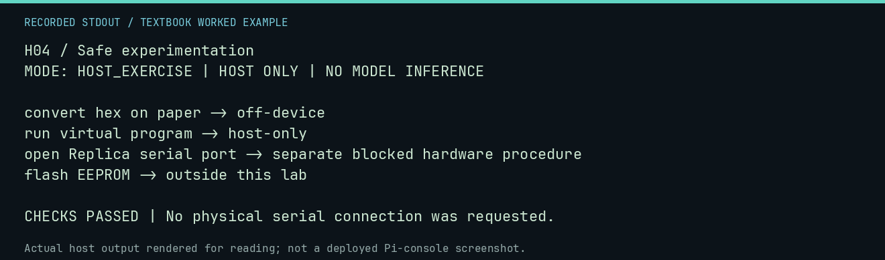

# H04 worked lab: Safe experimentation

[Lesson](README.md) · [Activity](ACTIVITY.md) · [Answers](ANSWERS.md) · [Source notes](SOURCE-NOTES.md)

**Goal:** Classify the action before touching the machine.

**Mode:** `HOST_EXERCISE`. This companion runs on the host; it does not
change the original packet's paper activity or authorize physical Replica work.

## Understand the example

An off-device computation and a serial open have different effects. This is a worked classification exercise, not an authorization engine. A classroom label cannot approve a hardware procedure.

## Predict before running

Read the source below. Write down the expected printed values and the condition
that would make its checks fail. For a CPU trace, distinguish state before an
instruction from state after it. For a conceptual exercise, explain the rule
behind each classification rather than memorizing the printed label.

## Run it

From the checkout root with your environment active:

```bash
python -m tools.textbook run H04
```

The runner executes this [complete source](../../textbook/examples/H04.py):

```python
actions = {
    "convert hex on paper": "off-device",
    "run virtual program": "host-only",
    "open Replica serial port": "separate blocked hardware procedure",
    "flash EEPROM": "outside this lab",
}
for action, category in actions.items():
    print(action + " -> " + category)
assert actions["open Replica serial port"] != "host-only"
```

## Recorded result

This output was actually executed and checked. The image is a readable render
of that stdout, not a screenshot of the deployed Pi console. A teaching fixture
or a host analogue is not independent historical or physical evidence.

```text
H04 / Safe experimentation
MODE: HOST_EXERCISE | HOST ONLY | NO MODEL INFERENCE

convert hex on paper -> off-device
run virtual program -> host-only
open Replica serial port -> separate blocked hardware procedure
flash EEPROM -> outside this lab

CHECKS PASSED | No physical serial connection was requested.
```



[Raw output](../../textbook/captures/H04.txt) · [Capture manifest](../../textbook/captures/manifest.json)

## Change one thing

Why is a no-transmit serial open not automatically harmless here?

<details>
<summary>Compare your reasoning with the worked answer</summary>

The project recorded display corruption after such an open. Its physical evidence gate remains relevant.

</details>

## Check your understanding

Explain the result without reading the code aloud. Name one condition that the
example did not test. Keep your prediction, changed input, actual output, and
interpretation together in your lab notebook. Use the linked textbook chapter
and the original source records for the broader context and evidence limits.

[Textbook home](../../textbook/README.md) · Previous: [H03: Why provenance matters](../H03-why-provenance-matters/WORKED.md) · Next: [H05: The future history you are making](../H05-the-future-history-you-are-making/WORKED.md)
