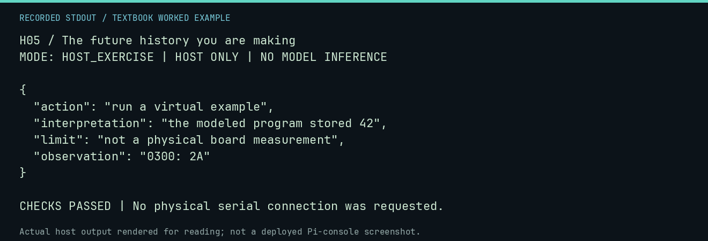

# H05 worked lab: The future history you are making

[Lesson](README.md) · [Activity](ACTIVITY.md) · [Answers](ANSWERS.md) · [Source notes](SOURCE-NOTES.md)

**Goal:** Keep observations separate from interpretations.

**Mode:** `HOST_EXERCISE`. This companion runs on the host; it does not
change the original packet's paper activity or authorize physical Replica work.

## Understand the example

A useful log records the action, observed result, and interpretation as different fields. This authored sample is a record-format exercise; it does not assert that a new physical observation occurred.

## Predict before running

Read the source below. Write down the expected printed values and the condition
that would make its checks fail. For a CPU trace, distinguish state before an
instruction from state after it. For a conceptual exercise, explain the rule
behind each classification rather than memorizing the printed label.

## Run it

From the checkout root with your environment active:

```bash
python -m tools.textbook run H05
```

The runner executes this [complete source](../../textbook/examples/H05.py):

```python
from tools.textbook_support import emit

record = {
    "action": "run a virtual example",
    "observation": "0300: 2A",
    "interpretation": "the modeled program stored 42",
    "limit": "not a physical board measurement",
}
emit(record)
assert "observation" in record and "limit" in record
```

## Recorded result

This output was actually executed and checked. The image is a readable render
of that stdout, not a screenshot of the deployed Pi console. A teaching fixture
or a host analogue is not independent historical or physical evidence.

```text
H05 / The future history you are making
MODE: HOST_EXERCISE | HOST ONLY | NO MODEL INFERENCE

{
  "action": "run a virtual example",
  "interpretation": "the modeled program stored 42",
  "limit": "not a physical board measurement",
  "observation": "0300: 2A"
}

CHECKS PASSED | No physical serial connection was requested.
```



[Raw output](../../textbook/captures/H05.txt) · [Capture manifest](../../textbook/captures/manifest.json)

## Change one thing

Where should you record a surprising result that contradicts your expectation?

<details>
<summary>Compare your reasoning with the worked answer</summary>

In observation, with the actual output retained. Put the hypothesis explaining it in interpretation.

</details>

## Check your understanding

Explain the result without reading the code aloud. Name one condition that the
example did not test. Keep your prediction, changed input, actual output, and
interpretation together in your lab notebook. Use the linked textbook chapter
and the original source records for the broader context and evidence limits.

[Textbook home](../../textbook/README.md) · Previous: [H04: Safe experimentation](../H04-safe-experimentation/WORKED.md) · Next: [H06: The monitor that wasn't](../H06-the-monitor-that-wasnt/WORKED.md)
