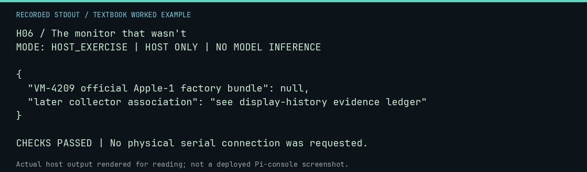

# H06 worked lab: The monitor that wasn't

[Lesson](README.md) · [Activity](ACTIVITY.md) · [Answers](ANSWERS.md) · [Source notes](SOURCE-NOTES.md)

**Goal:** Preserve unknowns in a collection claim.

**Mode:** `HOST_EXERCISE`. This companion runs on the host; it does not
change the original packet's paper activity or authorize physical Replica work.

## Understand the example

A later display can be associated with a historical computer without being its original bundled display. This exercise intentionally leaves a claim unknown instead of filling the gap from an attractive photograph.

## Predict before running

Read the source below. Write down the expected printed values and the condition
that would make its checks fail. For a CPU trace, distinguish state before an
instruction from state after it. For a conceptual exercise, explain the rule
behind each classification rather than memorizing the printed label.

## Run it

From the checkout root with your environment active:

```bash
python -m tools.textbook run H06
```

The runner executes this [complete source](../../textbook/examples/H06.py):

```python
from tools.textbook_support import emit

claims = {"VM-4209 official Apple-1 factory bundle": None, "later collector association": "see display-history evidence ledger"}
emit(claims)
assert claims["VM-4209 official Apple-1 factory bundle"] is None
```

## Recorded result

This output was actually executed and checked. The image is a readable render
of that stdout, not a screenshot of the deployed Pi console. A teaching fixture
or a host analogue is not independent historical or physical evidence.

```text
H06 / The monitor that wasn't
MODE: HOST_EXERCISE | HOST ONLY | NO MODEL INFERENCE

{
  "VM-4209 official Apple-1 factory bundle": null,
  "later collector association": "see display-history evidence ledger"
}

CHECKS PASSED | No physical serial connection was requested.
```



[Raw output](../../textbook/captures/H06.txt) · [Capture manifest](../../textbook/captures/manifest.json)

## Change one thing

Would a modern museum pairing establish a 1976 factory bundle?

<details>
<summary>Compare your reasoning with the worked answer</summary>

No. It establishes a display choice in that later context. Check the lesson sources and image provenance.

</details>

## Check your understanding

Explain the result without reading the code aloud. Name one condition that the
example did not test. Keep your prediction, changed input, actual output, and
interpretation together in your lab notebook. Use the linked textbook chapter
and the original source records for the broader context and evidence limits.

[Textbook home](../../textbook/README.md) · Previous: [H05: The future history you are making](../H05-the-future-history-you-are-making/WORKED.md) · Next: [X01: Hex scavenger hunt](../X01-hex-scavenger-hunt/WORKED.md)
