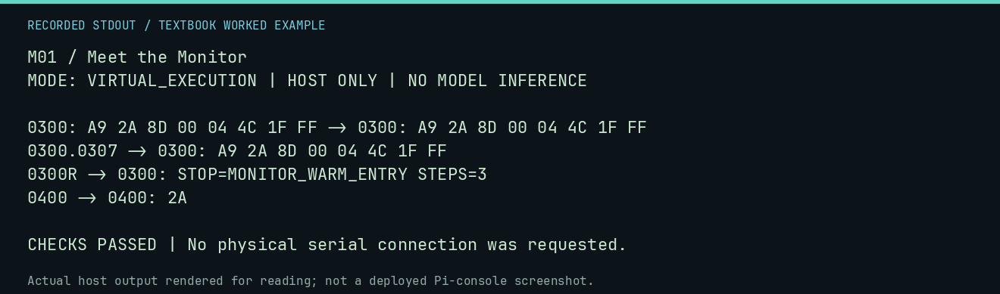

# M01 worked lab: Meet the Monitor

[Lesson](README.md) · [Activity](ACTIVITY.md) · [Answers](ANSWERS.md) · [Source notes](SOURCE-NOTES.md)

**Goal:** Use the three Monitor operations.

**Mode:** `VIRTUAL_EXECUTION`. This companion runs on the host; it does not
change the original packet's paper activity or authorize physical Replica work.

## Understand the example

The modeled Monitor can inspect, deposit, and run. It is a tiny machine interface, not a host shell or an assembler. Here the exact byte string is deposited in virtual memory before the run command is accepted.

## Predict before running

Read the source below. Write down the expected printed values and the condition
that would make its checks fail. For a CPU trace, distinguish state before an
instruction from state after it. For a conceptual exercise, explain the rule
behind each classification rather than memorizing the printed label.

## Run it

From the checkout root with your environment active:

```bash
python -m tools.textbook run M01
```

The runner executes this [complete source](../../textbook/examples/M01.py):

```python
from neural1.world import VirtualApple1World, WozMonSession

w = VirtualApple1World()
m = WozMonSession(w)
for command in ("0300: A9 2A 8D 00 04 4C 1F FF", "0300.0307", "0300R", "0400"):
    print(command, "->", m.transact(command))
assert w.host_read(0x400)[0] == 42
```

## Recorded result

This output was actually executed and checked. The image is a readable render
of that stdout, not a screenshot of the deployed Pi console. A teaching fixture
or a host analogue is not independent historical or physical evidence.

```text
M01 / Meet the Monitor
MODE: VIRTUAL_EXECUTION | HOST ONLY | NO MODEL INFERENCE

0300: A9 2A 8D 00 04 4C 1F FF -> 0300: A9 2A 8D 00 04 4C 1F FF
0300.0307 -> 0300: A9 2A 8D 00 04 4C 1F FF
0300R -> 0300: STOP=MONITOR_WARM_ENTRY STEPS=3
0400 -> 0400: 2A

CHECKS PASSED | No physical serial connection was requested.
```



[Raw output](../../textbook/captures/M01.txt) · [Capture manifest](../../textbook/captures/manifest.json)

## Change one thing

Will LOAD PROGRAM work in this modeled Monitor?

<details>
<summary>Compare your reasoning with the worked answer</summary>

No. Assembly and host shell commands are not Monitor commands.

</details>

## Check your understanding

Explain the result without reading the code aloud. Name one condition that the
example did not test. Keep your prediction, changed input, actual output, and
interpretation together in your lab notebook. Use the linked textbook chapter
and the original source records for the broader context and evidence limits.

[Textbook home](../../textbook/README.md) · Previous: [C05: Instructions change state](../C05-instructions-change-state/WORKED.md) · Next: [M02: Addresses and byte entry](../M02-addresses-and-byte-entry/WORKED.md)
