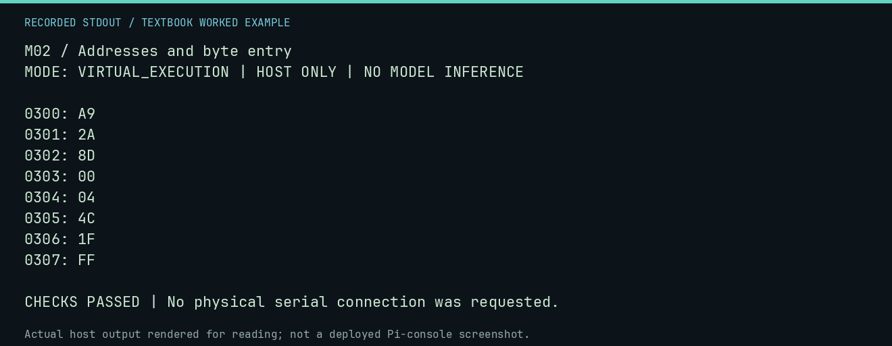

# M02 worked lab: Addresses and byte entry

[Lesson](README.md) · [Activity](ACTIVITY.md) · [Answers](ANSWERS.md) · [Source notes](SOURCE-NOTES.md)

**Goal:** Explain origin and little-endian operands.

**Mode:** `VIRTUAL_EXECUTION`. This companion runs on the host; it does not
change the original packet's paper activity or authorize physical Replica work.

## Understand the example

An absolute address occupies two operand bytes, low byte first. STA $0400 becomes 8D 00 04. The origin determines where instruction bytes live; it does not change the destination of that absolute store.

## Predict before running

Read the source below. Write down the expected printed values and the condition
that would make its checks fail. For a CPU trace, distinguish state before an
instruction from state after it. For a conceptual exercise, explain the rule
behind each classification rather than memorizing the printed label.

## Run it

From the checkout root with your environment active:

```bash
python -m tools.textbook run M02
```

The runner executes this [complete source](../../textbook/examples/M02.py):

```python
from neural1.assembler import LessonAssembler

r = LessonAssembler().assemble("LDA #$2A\nSTA $0400\nJMP $FF1F", origin=0x300)
assert not r.diagnostics
for i, byte in enumerate(r.payload):
    print(f"{r.origin + i:04X}: {byte:02X}")
assert r.payload[3:5] == bytes.fromhex("00 04")
```

## Recorded result

This output was actually executed and checked. The image is a readable render
of that stdout, not a screenshot of the deployed Pi console. A teaching fixture
or a host analogue is not independent historical or physical evidence.

```text
M02 / Addresses and byte entry
MODE: VIRTUAL_EXECUTION | HOST ONLY | NO MODEL INFERENCE

0300: A9
0301: 2A
0302: 8D
0303: 00
0304: 04
0305: 4C
0306: 1F
0307: FF

CHECKS PASSED | No physical serial connection was requested.
```



[Raw output](../../textbook/captures/M02.txt) · [Capture manifest](../../textbook/captures/manifest.json)

## Change one thing

What bytes encode the address $1234?

<details>
<summary>Compare your reasoning with the worked answer</summary>

34 12, low byte then high byte.

</details>

## Check your understanding

Explain the result without reading the code aloud. Name one condition that the
example did not test. Keep your prediction, changed input, actual output, and
interpretation together in your lab notebook. Use the linked textbook chapter
and the original source records for the broader context and evidence limits.

[Textbook home](../../textbook/README.md) · Previous: [M01: Meet the Monitor](../M01-meet-the-monitor/WORKED.md) · Next: [M03: A safe rehearsal loop](../M03-a-safe-rehearsal-loop/WORKED.md)
