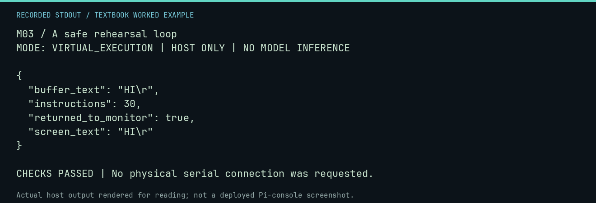

# M03 worked lab: A safe rehearsal loop

[Lesson](README.md) · [Activity](ACTIVITY.md) · [Answers](ANSWERS.md) · [Source notes](SOURCE-NOTES.md)

**Goal:** Predict an echo before running it.

**Mode:** `VIRTUAL_EXECUTION`. This companion runs on the host; it does not
change the original packet's paper activity or authorize physical Replica work.

## Understand the example

The line-input harness feeds HI followed by carriage return. It records the screen, the stored buffer, instruction count, and the return path. A matching test supports this program in this harness; it does not establish serial or electrical behavior.

## Predict before running

Read the source below. Write down the expected printed values and the condition
that would make its checks fail. For a CPU trace, distinguish state before an
instruction from state after it. For a conceptual exercise, explain the rule
behind each classification rather than memorizing the printed label.

## Run it

From the checkout root with your environment active:

```bash
python -m tools.textbook run M03
```

The runner executes this [complete source](../../textbook/examples/M03.py):

```python
from tools.textbook_support import echo

r = echo("HI\r")
assert r.screen_text == r.buffer_text == "HI\r"
assert r.instructions == 30 and r.returned_to_monitor
```

## Recorded result

This output was actually executed and checked. The image is a readable render
of that stdout, not a screenshot of the deployed Pi console. A teaching fixture
or a host analogue is not independent historical or physical evidence.

```text
M03 / A safe rehearsal loop
MODE: VIRTUAL_EXECUTION | HOST ONLY | NO MODEL INFERENCE

{
  "buffer_text": "HI\r",
  "instructions": 30,
  "returned_to_monitor": true,
  "screen_text": "HI\r"
}

CHECKS PASSED | No physical serial connection was requested.
```



[Raw output](../../textbook/captures/M03.txt) · [Capture manifest](../../textbook/captures/manifest.json)

## Change one thing

Try A + Return and compare against HI + Return.

<details>
<summary>Compare your reasoning with the worked answer</summary>

One fewer ordinary character reduces the work. Record the actual count rather than assuming a timing measurement.

</details>

## Check your understanding

Explain the result without reading the code aloud. Name one condition that the
example did not test. Keep your prediction, changed input, actual output, and
interpretation together in your lab notebook. Use the linked textbook chapter
and the original source records for the broader context and evidence limits.

[Textbook home](../../textbook/README.md) · Previous: [M02: Addresses and byte entry](../M02-addresses-and-byte-entry/WORKED.md) · Next: [M04: Debugging as observation](../M04-debugging-as-observation/WORKED.md)
