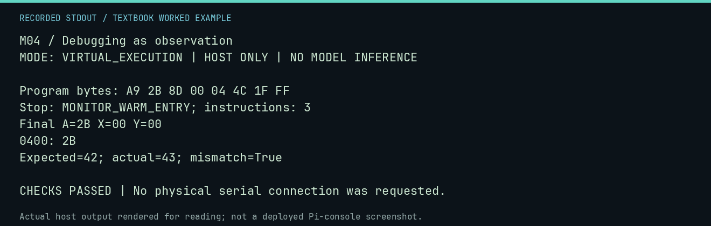

# M04 worked lab: Debugging as observation

[Lesson](README.md) · [Activity](ACTIVITY.md) · [Answers](ANSWERS.md) · [Source notes](SOURCE-NOTES.md)

**Goal:** Compare expectation with observation.

**Mode:** `VIRTUAL_EXECUTION`. This companion runs on the host; it does not
change the original packet's paper activity or authorize physical Replica work.

## Understand the example

An expected value is useful only if it was written before observing the result. A mismatch is a reason to investigate both the code and the expectation. This deliberate mistake is detected by a numeric comparison rather than hidden.

## Predict before running

Read the source below. Write down the expected printed values and the condition
that would make its checks fail. For a CPU trace, distinguish state before an
instruction from state after it. For a conceptual exercise, explain the rule
behind each classification rather than memorizing the printed label.

## Run it

From the checkout root with your environment active:

```bash
python -m tools.textbook run M04
```

The runner executes this [complete source](../../textbook/examples/M04.py):

```python
from tools.textbook_support import cpu

w, r, a = cpu("LDA #$2B\nSTA $0400\nJMP $FF1F")
expected, actual = 42, w.host_read(0x400)[0]
print(f"Expected={expected}; actual={actual}; mismatch={expected != actual}")
assert actual == 43 and actual != expected
```

## Recorded result

This output was actually executed and checked. The image is a readable render
of that stdout, not a screenshot of the deployed Pi console. A teaching fixture
or a host analogue is not independent historical or physical evidence.

```text
M04 / Debugging as observation
MODE: VIRTUAL_EXECUTION | HOST ONLY | NO MODEL INFERENCE

Program bytes: A9 2B 8D 00 04 4C 1F FF
Stop: MONITOR_WARM_ENTRY; instructions: 3
Final A=2B X=00 Y=00
0400: 2B
Expected=42; actual=43; mismatch=True

CHECKS PASSED | No physical serial connection was requested.
```



[Raw output](../../textbook/captures/M04.txt) · [Capture manifest](../../textbook/captures/manifest.json)

## Change one thing

What single change could test whether the immediate operand caused the mismatch?

<details>
<summary>Compare your reasoning with the worked answer</summary>

Change only #$2B to #$2A, preserve the first result, and compare the rerun.

</details>

## Check your understanding

Explain the result without reading the code aloud. Name one condition that the
example did not test. Keep your prediction, changed input, actual output, and
interpretation together in your lab notebook. Use the linked textbook chapter
and the original source records for the broader context and evidence limits.

[Textbook home](../../textbook/README.md) · Previous: [M03: A safe rehearsal loop](../M03-a-safe-rehearsal-loop/WORKED.md) · Next: [M05: Why `JMP $FF1F` matters](../M05-why-jmp-ff1f-matters/WORKED.md)
