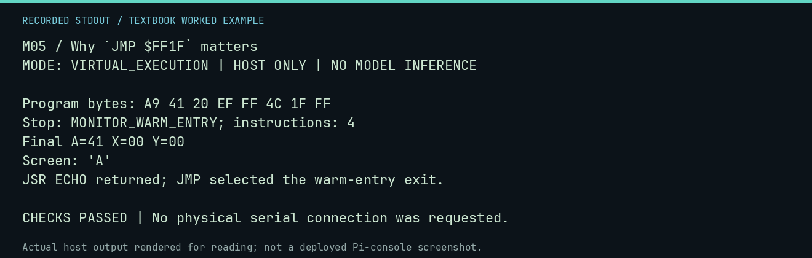

# M05 worked lab: Why `JMP $FF1F` matters

[Lesson](README.md) · [Activity](ACTIVITY.md) · [Answers](ANSWERS.md) · [Source notes](SOURCE-NOTES.md)

**Goal:** Separate a warm-entry jump from a subroutine return.

**Mode:** `VIRTUAL_EXECUTION`. This companion runs on the host; it does not
change the original packet's paper activity or authorize physical Replica work.

## Understand the example

A JMP transfers control directly. RTS expects a return address placed on the stack by a compatible call. These examples entered at the lab origin, so no caller return address is promised. A deliberate JMP $FF1F gives this virtual harness a defined exit.

## Predict before running

Read the source below. Write down the expected printed values and the condition
that would make its checks fail. For a CPU trace, distinguish state before an
instruction from state after it. For a conceptual exercise, explain the rule
behind each classification rather than memorizing the printed label.

## Run it

From the checkout root with your environment active:

```bash
python -m tools.textbook run M05
```

The runner executes this [complete source](../../textbook/examples/M05.py):

```python
from tools.textbook_support import cpu

w, r, a = cpu("LDA #$41\nJSR $FFEF\nJMP $FF1F", inspect=())
assert r.screen_text == "A" and r.stop_reason == "MONITOR_WARM_ENTRY"
print("JSR ECHO returned; JMP selected the warm-entry exit.")
```

## Recorded result

This output was actually executed and checked. The image is a readable render
of that stdout, not a screenshot of the deployed Pi console. A teaching fixture
or a host analogue is not independent historical or physical evidence.

```text
M05 / Why `JMP $FF1F` matters
MODE: VIRTUAL_EXECUTION | HOST ONLY | NO MODEL INFERENCE

Program bytes: A9 41 20 EF FF 4C 1F FF
Stop: MONITOR_WARM_ENTRY; instructions: 4
Final A=41 X=00 Y=00
Screen: 'A'
JSR ECHO returned; JMP selected the warm-entry exit.

CHECKS PASSED | No physical serial connection was requested.
```



[Raw output](../../textbook/captures/M05.txt) · [Capture manifest](../../textbook/captures/manifest.json)

## Change one thing

Why is RTS appropriate after JSR ECHO but not an automatic substitute for the final JMP?

<details>
<summary>Compare your reasoning with the worked answer</summary>

JSR creates a return address for that call; the program entry path need not have done so.

</details>

## Check your understanding

Explain the result without reading the code aloud. Name one condition that the
example did not test. Keep your prediction, changed input, actual output, and
interpretation together in your lab notebook. Use the linked textbook chapter
and the original source records for the broader context and evidence limits.

[Textbook home](../../textbook/README.md) · Previous: [M04: Debugging as observation](../M04-debugging-as-observation/WORKED.md) · Next: [A01: Read an instruction](../A01-read-an-instruction/WORKED.md)
