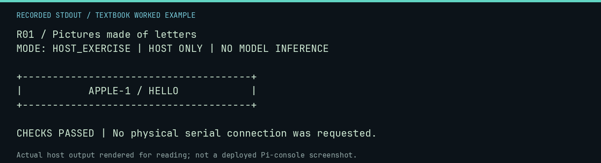

# R01 worked lab: Pictures made of letters

[Lesson](README.md) · [Activity](ACTIVITY.md) · [Answers](ANSWERS.md) · [Source notes](SOURCE-NOTES.md)

**Goal:** Design within a 40-column text grid.

**Mode:** `HOST_EXERCISE`. This companion runs on the host; it does not
change the original packet's paper activity or authorize physical Replica work.

## Understand the example

ASCII art is a layout problem with a fixed character budget. Count characters rather than judging the width by eye. These lines use only uppercase seven-bit printable characters and spaces.

## Predict before running

Read the source below. Write down the expected printed values and the condition
that would make its checks fail. For a CPU trace, distinguish state before an
instruction from state after it. For a conceptual exercise, explain the rule
behind each classification rather than memorizing the printed label.

## Run it

From the checkout root with your environment active:

```bash
python -m tools.textbook run R01
```

The runner executes this [complete source](../../textbook/examples/R01.py):

```python
lines = ["+" + "-" * 38 + "+", "|" + "APPLE-1 / HELLO".center(38) + "|", "+" + "-" * 38 + "+"]
for line in lines:
    print(line)
    assert len(line) == 40 and all(32 <= ord(c) <= 126 for c in line)
```

## Recorded result

This output was actually executed and checked. The image is a readable render
of that stdout, not a screenshot of the deployed Pi console. A teaching fixture
or a host analogue is not independent historical or physical evidence.

```text
R01 / Pictures made of letters
MODE: HOST_EXERCISE | HOST ONLY | NO MODEL INFERENCE

+--------------------------------------+
|           APPLE-1 / HELLO            |
+--------------------------------------+

CHECKS PASSED | No physical serial connection was requested.
```



[Raw output](../../textbook/captures/R01.txt) · [Capture manifest](../../textbook/captures/manifest.json)

## Change one thing

Add your own title without changing the border width.

<details>
<summary>Compare your reasoning with the worked answer</summary>

The interior is 38 characters; reject or shorten longer text before centering.

</details>

## Check your understanding

Explain the result without reading the code aloud. Name one condition that the
example did not test. Keep your prediction, changed input, actual output, and
interpretation together in your lab notebook. Use the linked textbook chapter
and the original source records for the broader context and evidence limits.

[Textbook home](../../textbook/README.md) · Previous: [B05: Data, files, and the CF card](../B05-data-files-and-the-cf-card/WORKED.md) · Next: [R02: Motion is many pictures](../R02-motion-is-many-pictures/WORKED.md)
