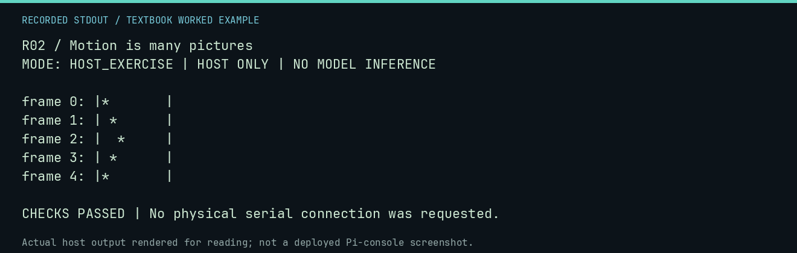

# R02 worked lab: Motion is many pictures

[Lesson](README.md) · [Activity](ACTIVITY.md) · [Answers](ANSWERS.md) · [Source notes](SOURCE-NOTES.md)

**Goal:** Model animation as frames and state.

**Mode:** `HOST_EXERCISE`. This companion runs on the host; it does not
change the original packet's paper activity or authorize physical Replica work.

## Understand the example

An animation can be described by position and direction. These host-generated frames show state updates, not display timing or cursor addressing on the Apple-1. A time delay and a display update mechanism would be additional implementation work.

## Predict before running

Read the source below. Write down the expected printed values and the condition
that would make its checks fail. For a CPU trace, distinguish state before an
instruction from state after it. For a conceptual exercise, explain the rule
behind each classification rather than memorizing the printed label.

## Run it

From the checkout root with your environment active:

```bash
python -m tools.textbook run R02
```

The runner executes this [complete source](../../textbook/examples/R02.py):

```python
positions = [0, 1, 2, 1, 0]
for frame, position in enumerate(positions):
    print(f"frame {frame}: |" + (" " * position + "*").ljust(8) + "|")
assert positions[0] == positions[-1]
```

## Recorded result

This output was actually executed and checked. The image is a readable render
of that stdout, not a screenshot of the deployed Pi console. A teaching fixture
or a host analogue is not independent historical or physical evidence.

```text
R02 / Motion is many pictures
MODE: HOST_EXERCISE | HOST ONLY | NO MODEL INFERENCE

frame 0: |*       |
frame 1: | *      |
frame 2: |  *     |
frame 3: | *      |
frame 4: |*       |

CHECKS PASSED | No physical serial connection was requested.
```



[Raw output](../../textbook/captures/R02.txt) · [Capture manifest](../../textbook/captures/manifest.json)

## Change one thing

What state is needed for a bouncing symbol beyond its position?

<details>
<summary>Compare your reasoning with the worked answer</summary>

Its direction, and the boundaries of its allowed movement.

</details>

## Check your understanding

Explain the result without reading the code aloud. Name one condition that the
example did not test. Keep your prediction, changed input, actual output, and
interpretation together in your lab notebook. Use the linked textbook chapter
and the original source records for the broader context and evidence limits.

[Textbook home](../../textbook/README.md) · Previous: [R01: Pictures made of letters](../R01-pictures-made-of-letters/WORKED.md) · Next: [R03: Generative patterns](../R03-generative-patterns/WORKED.md)
