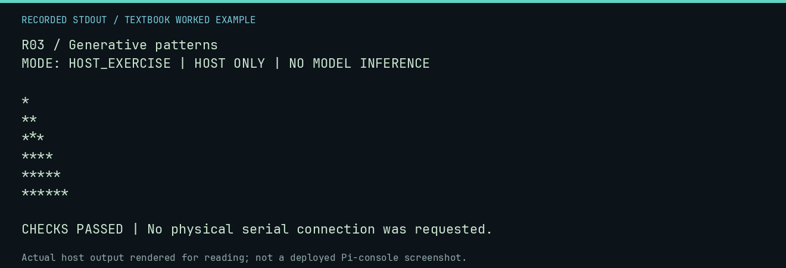

# R03 worked lab: Generative patterns

[Lesson](README.md) · [Activity](ACTIVITY.md) · [Answers](ANSWERS.md) · [Source notes](SOURCE-NOTES.md)

**Goal:** Generate a pattern from a compact rule.

**Mode:** `HOST_EXERCISE`. This companion runs on the host; it does not
change the original packet's paper activity or authorize physical Replica work.

## Understand the example

A rule can describe many rows more compactly than storing every character. This triangular pattern has a simple row counter. Compact description is not evidence of learning, emergence, or randomness.

## Predict before running

Read the source below. Write down the expected printed values and the condition
that would make its checks fail. For a CPU trace, distinguish state before an
instruction from state after it. For a conceptual exercise, explain the rule
behind each classification rather than memorizing the printed label.

## Run it

From the checkout root with your environment active:

```bash
python -m tools.textbook run R03
```

The runner executes this [complete source](../../textbook/examples/R03.py):

```python
for row in range(1, 7):
    text = "*" * row
    print(text)
    assert len(text) == row
```

## Recorded result

This output was actually executed and checked. The image is a readable render
of that stdout, not a screenshot of the deployed Pi console. A teaching fixture
or a host analogue is not independent historical or physical evidence.

```text
R03 / Generative patterns
MODE: HOST_EXERCISE | HOST ONLY | NO MODEL INFERENCE

*
**
***
****
*****
******

CHECKS PASSED | No physical serial connection was requested.
```



[Raw output](../../textbook/captures/R03.txt) · [Capture manifest](../../textbook/captures/manifest.json)

## Change one thing

How many stars occur in the first six rows?

<details>
<summary>Compare your reasoning with the worked answer</summary>

1+2+3+4+5+6 = 21. Compare a stored image with the size and runtime cost of a generator.

</details>

## Check your understanding

Explain the result without reading the code aloud. Name one condition that the
example did not test. Keep your prediction, changed input, actual output, and
interpretation together in your lab notebook. Use the linked textbook chapter
and the original source records for the broader context and evidence limits.

[Textbook home](../../textbook/README.md) · Previous: [R02: Motion is many pictures](../R02-motion-is-many-pictures/WORKED.md) · Next: [R04: Interactive fiction](../R04-interactive-fiction/WORKED.md)
