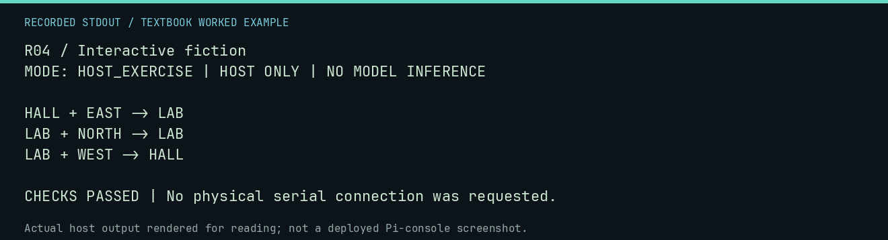

# R04 worked lab: Interactive fiction

[Lesson](README.md) · [Activity](ACTIVITY.md) · [Answers](ANSWERS.md) · [Source notes](SOURCE-NOTES.md)

**Goal:** Represent a story as explicit state transitions.

**Mode:** `HOST_EXERCISE`. This companion runs on the host; it does not
change the original packet's paper activity or authorize physical Replica work.

## Understand the example

A room is state; an action selects a transition. An unavailable exit must have defined behavior. This host example makes invalid movement stay in the current room instead of accidentally selecting another one.

## Predict before running

Read the source below. Write down the expected printed values and the condition
that would make its checks fail. For a CPU trace, distinguish state before an
instruction from state after it. For a conceptual exercise, explain the rule
behind each classification rather than memorizing the printed label.

## Run it

From the checkout root with your environment active:

```bash
python -m tools.textbook run R04
```

The runner executes this [complete source](../../textbook/examples/R04.py):

```python
rooms = {"HALL": {"EAST": "LAB"}, "LAB": {"WEST": "HALL"}}
state = "HALL"
for action in ("EAST", "NORTH", "WEST"):
    previous = state
    state = rooms[state].get(action, state)
    print(f"{previous} + {action} -> {state}")
assert state == "HALL"
```

## Recorded result

This output was actually executed and checked. The image is a readable render
of that stdout, not a screenshot of the deployed Pi console. A teaching fixture
or a host analogue is not independent historical or physical evidence.

```text
R04 / Interactive fiction
MODE: HOST_EXERCISE | HOST ONLY | NO MODEL INFERENCE

HALL + EAST -> LAB
LAB + NORTH -> LAB
LAB + WEST -> HALL

CHECKS PASSED | No physical serial connection was requested.
```



[Raw output](../../textbook/captures/R04.txt) · [Capture manifest](../../textbook/captures/manifest.json)

## Change one thing

Where would you store whether a key has been collected?

<details>
<summary>Compare your reasoning with the worked answer</summary>

In separate persistent game state; the current room alone cannot represent inventory.

</details>

## Check your understanding

Explain the result without reading the code aloud. Name one condition that the
example did not test. Keep your prediction, changed input, actual output, and
interpretation together in your lab notebook. Use the linked textbook chapter
and the original source records for the broader context and evidence limits.

[Textbook home](../../textbook/README.md) · Previous: [R03: Generative patterns](../R03-generative-patterns/WORKED.md) · Next: [R05: Sound, rhythm, and code](../R05-sound-rhythm-and-code/WORKED.md)
