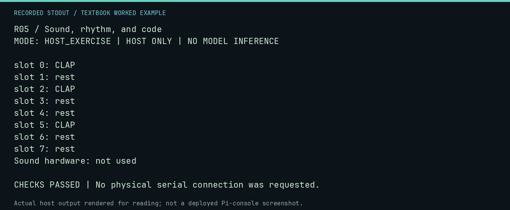

# R05 worked lab: Sound, rhythm, and code

[Lesson](README.md) · [Activity](ACTIVITY.md) · [Answers](ANSWERS.md) · [Source notes](SOURCE-NOTES.md)

**Goal:** Encode a rhythm without claiming audio hardware.

**Mode:** `HOST_EXERCISE`. This companion runs on the host; it does not
change the original packet's paper activity or authorize physical Replica work.

## Understand the example

Bits can encode events over equal conceptual time slots. A one means a clap and zero a rest. The same bits do not specify tempo, duration, volume, pitch, or a sound device.

## Predict before running

Read the source below. Write down the expected printed values and the condition
that would make its checks fail. For a CPU trace, distinguish state before an
instruction from state after it. For a conceptual exercise, explain the rule
behind each classification rather than memorizing the printed label.

## Run it

From the checkout root with your environment active:

```bash
python -m tools.textbook run R05
```

The runner executes this [complete source](../../textbook/examples/R05.py):

```python
rhythm = 0b10100100
for slot in range(8):
    event = bool(rhythm & (1 << (7 - slot)))
    print(f"slot {slot}: " + ("CLAP" if event else "rest"))
assert rhythm.bit_count() == 3
print("Sound hardware: not used")
```

## Recorded result

This output was actually executed and checked. The image is a readable render
of that stdout, not a screenshot of the deployed Pi console. A teaching fixture
or a host analogue is not independent historical or physical evidence.

```text
R05 / Sound, rhythm, and code
MODE: HOST_EXERCISE | HOST ONLY | NO MODEL INFERENCE

slot 0: CLAP
slot 1: rest
slot 2: CLAP
slot 3: rest
slot 4: rest
slot 5: CLAP
slot 6: rest
slot 7: rest
Sound hardware: not used

CHECKS PASSED | No physical serial connection was requested.
```



[Raw output](../../textbook/captures/R05.txt) · [Capture manifest](../../textbook/captures/manifest.json)

## Change one thing

What extra parameter turns the slots into a tempo?

<details>
<summary>Compare your reasoning with the worked answer</summary>

A defined time per slot. Generating sound also needs a compatible output mechanism.

</details>

## Check your understanding

Explain the result without reading the code aloud. Name one condition that the
example did not test. Keep your prediction, changed input, actual output, and
interpretation together in your lab notebook. Use the linked textbook chapter
and the original source records for the broader context and evidence limits.

[Textbook home](../../textbook/README.md) · Previous: [R04: Interactive fiction](../R04-interactive-fiction/WORKED.md) · Next: [H01: The 1976 personal-computing moment](../H01-the-1976-personal-computing-moment/WORKED.md)
