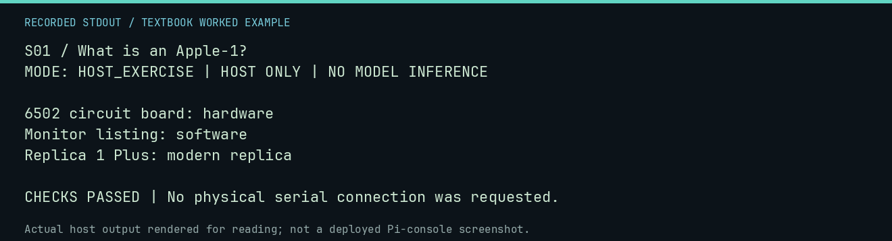

# S01 worked lab: What is an Apple-1?

[Lesson](README.md) · [Activity](ACTIVITY.md) · [Answers](ANSWERS.md) · [Source notes](SOURCE-NOTES.md)

**Goal:** Separate the computer, program, and replica.

**Mode:** `HOST_EXERCISE`. This companion runs on the host; it does not
change the original packet's paper activity or authorize physical Replica work.

## Understand the example

A CPU executes instructions, a program supplies them, and a replica is a physical implementation of a historical design. A name on a screen is not evidence of the identity of a board. This exercise labels teaching objects rather than authenticating a collection item.

## Predict before running

Read the source below. Write down the expected printed values and the condition
that would make its checks fail. For a CPU trace, distinguish state before an
instruction from state after it. For a conceptual exercise, explain the rule
behind each classification rather than memorizing the printed label.

## Run it

From the checkout root with your environment active:

```bash
python -m tools.textbook run S01
```

The runner executes this [complete source](../../textbook/examples/S01.py):

```python
objects = {"6502 circuit board": "hardware", "Monitor listing": "software", "Replica 1 Plus": "modern replica"}
for name, kind in objects.items():
    print(f"{name}: {kind}")
assert objects["Monitor listing"] == "software"
```

## Recorded result

This output was actually executed and checked. The image is a readable render
of that stdout, not a screenshot of the deployed Pi console. A teaching fixture
or a host analogue is not independent historical or physical evidence.

```text
S01 / What is an Apple-1?
MODE: HOST_EXERCISE | HOST ONLY | NO MODEL INFERENCE

6502 circuit board: hardware
Monitor listing: software
Replica 1 Plus: modern replica

CHECKS PASSED | No physical serial connection was requested.
```



[Raw output](../../textbook/captures/S01.txt) · [Capture manifest](../../textbook/captures/manifest.json)

## Change one thing

Where does NEURAL1 belong, and where does the Pi belong?

<details>
<summary>Compare your reasoning with the worked answer</summary>

NEURAL1 is modern host software; the Pi is its physical host. The Apple-1 execution target in these labs is virtual.

</details>

## Check your understanding

Explain the result without reading the code aloud. Name one condition that the
example did not test. Keep your prediction, changed input, actual output, and
interpretation together in your lab notebook. Use the linked textbook chapter
and the original source records for the broader context and evidence limits.

[Textbook home](../../textbook/README.md) · Next: [S02: A computer is not magic](../S02-a-computer-is-not-magic/WORKED.md)
