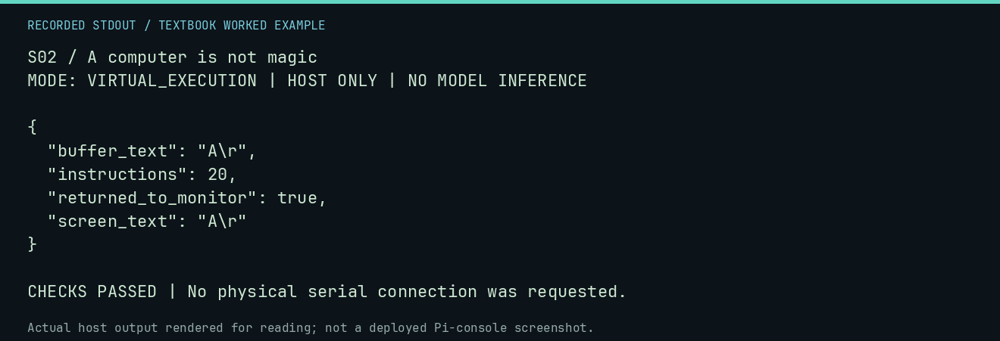

# S02 worked lab: A computer is not magic

[Lesson](README.md) · [Activity](ACTIVITY.md) · [Answers](ANSWERS.md) · [Source notes](SOURCE-NOTES.md)

**Goal:** Trace one character through the harness.

**Mode:** `VIRTUAL_EXECUTION`. This companion runs on the host; it does not
change the original packet's paper activity or authorize physical Replica work.

## Understand the example

The RAM harness supplies keyboard input, lets a 6502 program store it, and records the Monitor ECHO call. The visible letter and the stored byte are two observations of the same test, not a measurement of the physical keyboard path.

## Predict before running

Read the source below. Write down the expected printed values and the condition
that would make its checks fail. For a CPU trace, distinguish state before an
instruction from state after it. For a conceptual exercise, explain the rule
behind each classification rather than memorizing the printed label.

## Run it

From the checkout root with your environment active:

```bash
python -m tools.textbook run S02
```

The runner executes this [complete source](../../textbook/examples/S02.py):

```python
from tools.textbook_support import echo

r = echo("A\r")
assert r.screen_text == r.buffer_text == "A\r"
assert r.returned_to_monitor
```

## Recorded result

This output was actually executed and checked. The image is a readable render
of that stdout, not a screenshot of the deployed Pi console. A teaching fixture
or a host analogue is not independent historical or physical evidence.

```text
S02 / A computer is not magic
MODE: VIRTUAL_EXECUTION | HOST ONLY | NO MODEL INFERENCE

{
  "buffer_text": "A\r",
  "instructions": 20,
  "returned_to_monitor": true,
  "screen_text": "A\r"
}

CHECKS PASSED | No physical serial connection was requested.
```



[Raw output](../../textbook/captures/S02.txt) · [Capture manifest](../../textbook/captures/manifest.json)

## Change one thing

What changes for an empty line, containing only Return?

<details>
<summary>Compare your reasoning with the worked answer</summary>

The buffer and screen contain a carriage return. Try echo("\r") and compare the instruction count.

</details>

## Check your understanding

Explain the result without reading the code aloud. Name one condition that the
example did not test. Keep your prediction, changed input, actual output, and
interpretation together in your lab notebook. Use the linked textbook chapter
and the original source records for the broader context and evidence limits.

[Textbook home](../../textbook/README.md) · Previous: [S01: What is an Apple-1?](../S01-what-is-an-apple-1/WORKED.md) · Next: [S03: Your first hex number](../S03-your-first-hex-number/WORKED.md)
