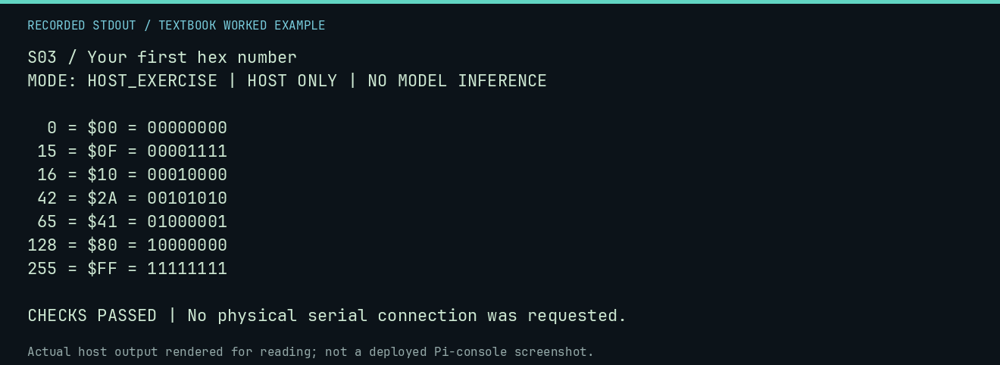

# S03 worked lab: Your first hex number

[Lesson](README.md) · [Activity](ACTIVITY.md) · [Answers](ANSWERS.md) · [Source notes](SOURCE-NOTES.md)

**Goal:** Convert bytes between decimal and hexadecimal.

**Mode:** `HOST_EXERCISE`. This companion runs on the host; it does not
change the original packet's paper activity or authorize physical Replica work.

## Understand the example

One hexadecimal digit represents four bits. Two digits represent a byte. Divide by 16: the quotient is the high digit and the remainder is the low digit. 42 = 2 times 16 + 10, so 42 is $2A.

## Predict before running

Read the source below. Write down the expected printed values and the condition
that would make its checks fail. For a CPU trace, distinguish state before an
instruction from state after it. For a conceptual exercise, explain the rule
behind each classification rather than memorizing the printed label.

## Run it

From the checkout root with your environment active:

```bash
python -m tools.textbook run S03
```

The runner executes this [complete source](../../textbook/examples/S03.py):

```python
for number in (0, 15, 16, 42, 65, 128, 255):
    print(f"{number:3d} = ${number:02X} = {number:08b}")
assert int("2A", 16) == 42
```

## Recorded result

This output was actually executed and checked. The image is a readable render
of that stdout, not a screenshot of the deployed Pi console. A teaching fixture
or a host analogue is not independent historical or physical evidence.

```text
S03 / Your first hex number
MODE: HOST_EXERCISE | HOST ONLY | NO MODEL INFERENCE

  0 = $00 = 00000000
 15 = $0F = 00001111
 16 = $10 = 00010000
 42 = $2A = 00101010
 65 = $41 = 01000001
128 = $80 = 10000000
255 = $FF = 11111111

CHECKS PASSED | No physical serial connection was requested.
```



[Raw output](../../textbook/captures/S03.txt) · [Capture manifest](../../textbook/captures/manifest.json)

## Change one thing

Convert 200 before running Python to check it.

<details>
<summary>Compare your reasoning with the worked answer</summary>

200 = 12*16+8, so $C8. A byte cannot contain 256; that needs a larger representation.

</details>

## Check your understanding

Explain the result without reading the code aloud. Name one condition that the
example did not test. Keep your prediction, changed input, actual output, and
interpretation together in your lab notebook. Use the linked textbook chapter
and the original source records for the broader context and evidence limits.

[Textbook home](../../textbook/README.md) · Previous: [S02: A computer is not magic](../S02-a-computer-is-not-magic/WORKED.md) · Next: [S04: Facts, models, and evidence](../S04-facts-models-and-evidence/WORKED.md)
