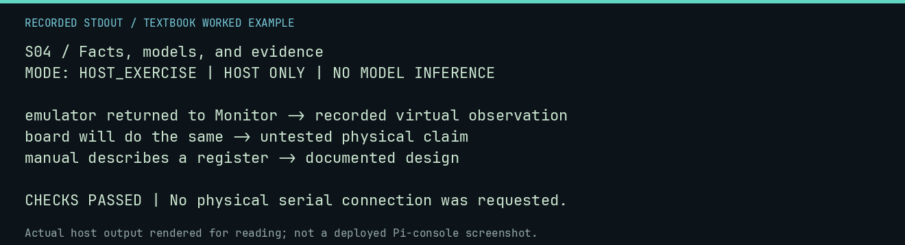

# S04 worked lab: Facts, models, and evidence

[Lesson](README.md) · [Activity](ACTIVITY.md) · [Answers](ANSWERS.md) · [Source notes](SOURCE-NOTES.md)

**Goal:** Distinguish an observation from a claim.

**Mode:** `HOST_EXERCISE`. This companion runs on the host; it does not
change the original packet's paper activity or authorize physical Replica work.

## Understand the example

A checksum, an emulator result, and a physical observation answer different questions. This fixture exercises labels; the labels themselves are a worked reasoning example. Explain why an observed virtual result cannot establish a live board result.

## Predict before running

Read the source below. Write down the expected printed values and the condition
that would make its checks fail. For a CPU trace, distinguish state before an
instruction from state after it. For a conceptual exercise, explain the rule
behind each classification rather than memorizing the printed label.

## Run it

From the checkout root with your environment active:

```bash
python -m tools.textbook run S04
```

The runner executes this [complete source](../../textbook/examples/S04.py):

```python
rows = [
    ("emulator returned to Monitor", "recorded virtual observation"),
    ("board will do the same", "untested physical claim"),
    ("manual describes a register", "documented design"),
]
for statement, kind in rows:
    print(statement + " -> " + kind)
assert rows[0][1] != rows[1][1]
```

## Recorded result

This output was actually executed and checked. The image is a readable render
of that stdout, not a screenshot of the deployed Pi console. A teaching fixture
or a host analogue is not independent historical or physical evidence.

```text
S04 / Facts, models, and evidence
MODE: HOST_EXERCISE | HOST ONLY | NO MODEL INFERENCE

emulator returned to Monitor -> recorded virtual observation
board will do the same -> untested physical claim
manual describes a register -> documented design

CHECKS PASSED | No physical serial connection was requested.
```



[Raw output](../../textbook/captures/S04.txt) · [Capture manifest](../../textbook/captures/manifest.json)

## Change one thing

Does a passing checksum authenticate an original Apple-1?

<details>
<summary>Compare your reasoning with the worked answer</summary>

No. It identifies matching bytes; provenance and physical authentication require different evidence.

</details>

## Check your understanding

Explain the result without reading the code aloud. Name one condition that the
example did not test. Keep your prediction, changed input, actual output, and
interpretation together in your lab notebook. Use the linked textbook chapter
and the original source records for the broader context and evidence limits.

[Textbook home](../../textbook/README.md) · Previous: [S03: Your first hex number](../S03-your-first-hex-number/WORKED.md) · Next: [C01: The 6502 at work](../C01-the-6502-at-work/WORKED.md)
