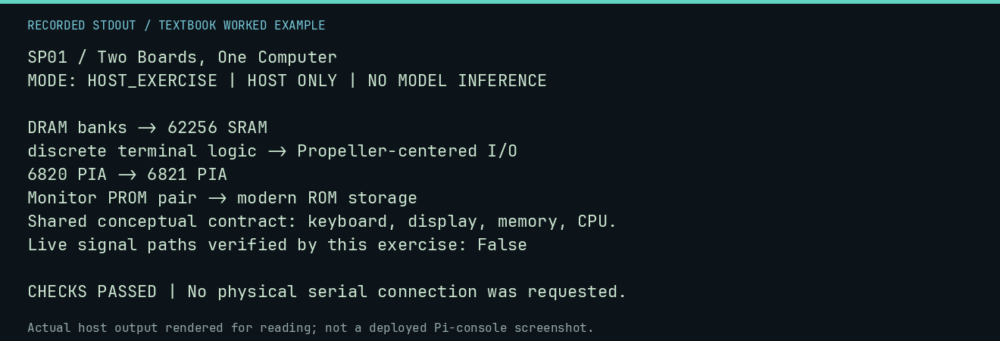

# SP01 worked lab: Two Boards, One Computer

[Lesson](README.md) · [Activity](ACTIVITY.md) · [Answers](ANSWERS.md) · [Source notes](SOURCE-NOTES.md)

**Goal:** Compare implementations without confusing the software contract.

**Mode:** `HOST_EXERCISE`. This companion runs on the host; it does not
change the original packet's paper activity or authorize physical Replica work.

## Understand the example

The existing atlas compares documented functions, not verified probe points. The mapping below is a reading exercise derived from that atlas. A similar address interface does not imply identical circuitry or timing.

## Predict before running

Read the source below. Write down the expected printed values and the condition
that would make its checks fail. For a CPU trace, distinguish state before an
instruction from state after it. For a conceptual exercise, explain the rule
behind each classification rather than memorizing the printed label.

## Run it

From the checkout root with your environment active:

```bash
python -m tools.textbook run SP01
```

The runner executes this [complete source](../../textbook/examples/SP01.py):

```python
for original, replica in [
    ("DRAM banks", "62256 SRAM"),
    ("discrete terminal logic", "Propeller-centered I/O"),
    ("6820 PIA", "6821 PIA"),
    ("Monitor PROM pair", "modern ROM storage"),
]:
    print(original + " -> " + replica)
print("Shared conceptual contract: keyboard, display, memory, CPU.")
print("Live signal paths verified by this exercise: False")
```

## Recorded result

This output was actually executed and checked. The image is a readable render
of that stdout, not a screenshot of the deployed Pi console. A teaching fixture
or a host analogue is not independent historical or physical evidence.

```text
SP01 / Two Boards, One Computer
MODE: HOST_EXERCISE | HOST ONLY | NO MODEL INFERENCE

DRAM banks -> 62256 SRAM
discrete terminal logic -> Propeller-centered I/O
6820 PIA -> 6821 PIA
Monitor PROM pair -> modern ROM storage
Shared conceptual contract: keyboard, display, memory, CPU.
Live signal paths verified by this exercise: False

CHECKS PASSED | No physical serial connection was requested.
```



[Raw output](../../textbook/captures/SP01.txt) · [Capture manifest](../../textbook/captures/manifest.json)

## Change one thing

Which substitutions would a program using the documented I/O addresses need to know about?

<details>
<summary>Compare your reasoning with the worked answer</summary>

The program depends on the software-visible contract; circuitry, electrical behavior, and timing still matter for physical compatibility.

</details>

## Check your understanding

Explain the result without reading the code aloud. Name one condition that the
example did not test. Keep your prediction, changed input, actual output, and
interpretation together in your lab notebook. Use the linked textbook chapter
and the original source records for the broader context and evidence limits.

[Textbook home](../../textbook/README.md) · Previous: [X05: Invent the next lesson](../X05-invent-the-next-lesson/WORKED.md) · Next: [F01: Validate console commands before work starts](../../textbook/features/F01.md)
