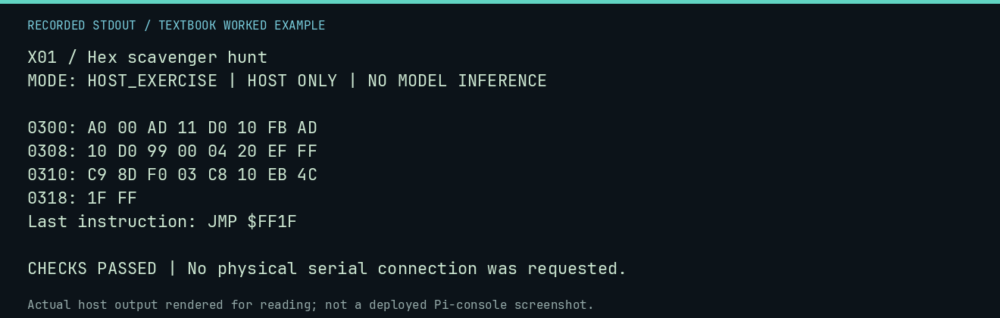

# X01 worked lab: Hex scavenger hunt

[Lesson](README.md) · [Activity](ACTIVITY.md) · [Answers](ANSWERS.md) · [Source notes](SOURCE-NOTES.md)

**Goal:** Decode a known byte artifact without calling it a live dump.

**Mode:** `HOST_EXERCISE`. This companion runs on the host; it does not
change the original packet's paper activity or authorize physical Replica work.

## Understand the example

The address column is computed from the stated origin. The bytes are read from the repository file, not memory on the Replica. Decode instructions using opcode boundaries rather than treating every occurrence of a byte as an opcode.

## Predict before running

Read the source below. Write down the expected printed values and the condition
that would make its checks fail. For a CPU trace, distinguish state before an
instruction from state after it. For a conceptual exercise, explain the rule
behind each classification rather than memorizing the printed label.

## Run it

From the checkout root with your environment active:

```bash
python -m tools.textbook run X01
```

The runner executes this [complete source](../../textbook/examples/X01.py):

```python
from tools.apple1_emulator import load_hex_program
from tools.textbook_support import ROOT

payload = load_hex_program(ROOT / "software/ram-only/line-input-0300.hex")
for offset in range(0, len(payload), 8):
    print(f"{0x300 + offset:04X}:", payload[offset : offset + 8].hex(" ").upper())
assert len(payload) == 26 and payload[-3:] == bytes.fromhex("4C 1F FF")
print("Last instruction: JMP $FF1F")
```

## Recorded result

This output was actually executed and checked. The image is a readable render
of that stdout, not a screenshot of the deployed Pi console. A teaching fixture
or a host analogue is not independent historical or physical evidence.

```text
X01 / Hex scavenger hunt
MODE: HOST_EXERCISE | HOST ONLY | NO MODEL INFERENCE

0300: A0 00 AD 11 D0 10 FB AD
0308: 10 D0 99 00 04 20 EF FF
0310: C9 8D F0 03 C8 10 EB 4C
0318: 1F FF
Last instruction: JMP $FF1F

CHECKS PASSED | No physical serial connection was requested.
```



[Raw output](../../textbook/captures/X01.txt) · [Capture manifest](../../textbook/captures/manifest.json)

## Change one thing

Why can the byte D0 mean something other than BNE in this listing?

<details>
<summary>Compare your reasoning with the worked answer</summary>

It can be an operand byte, such as the high byte of address $D010. Instruction boundaries determine interpretation.

</details>

## Check your understanding

Explain the result without reading the code aloud. Name one condition that the
example did not test. Keep your prediction, changed input, actual output, and
interpretation together in your lab notebook. Use the linked textbook chapter
and the original source records for the broader context and evidence limits.

[Textbook home](../../textbook/README.md) · Previous: [H06: The monitor that wasn't](../H06-the-monitor-that-wasnt/WORKED.md) · Next: [X02: Fix the loop](../X02-fix-the-loop/WORKED.md)
