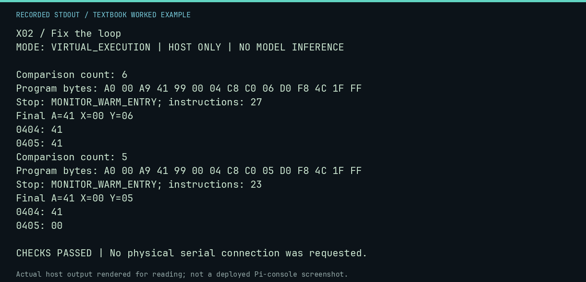

# X02 worked lab: Fix the loop

[Lesson](README.md) · [Activity](ACTIVITY.md) · [Answers](ANSWERS.md) · [Source notes](SOURCE-NOTES.md)

**Goal:** Expose a one-byte off-by-one error.

**Mode:** `VIRTUAL_EXECUTION`. This companion runs on the host; it does not
change the original packet's paper activity or authorize physical Replica work.

## Understand the example

The intended destination is five bytes long. The broken comparison uses six, so both programs return normally but one writes beyond the intended region. A successful return alone cannot detect this defect.

## Predict before running

Read the source below. Write down the expected printed values and the condition
that would make its checks fail. For a CPU trace, distinguish state before an
instruction from state after it. For a conceptual exercise, explain the rule
behind each classification rather than memorizing the printed label.

## Run it

From the checkout root with your environment active:

```bash
python -m tools.textbook run X02
```

The runner executes this [complete source](../../textbook/examples/X02.py):

```python
from tools.textbook_support import cpu

for count in (6, 5):
    print("Comparison count:", count)
    w, r, a = cpu(f"LDY #$00\nLDA #$41\nLOOP: STA $0400,Y\nINY\nCPY #${count:02X}\nBNE LOOP\nJMP $FF1F", inspect=(0x404, 0x405))
    assert w.host_read(0x405)[0] == (0x41 if count == 6 else 0)
    assert r.stop_reason == "MONITOR_WARM_ENTRY"
```

## Recorded result

This output was actually executed and checked. The image is a readable render
of that stdout, not a screenshot of the deployed Pi console. A teaching fixture
or a host analogue is not independent historical or physical evidence.

```text
X02 / Fix the loop
MODE: VIRTUAL_EXECUTION | HOST ONLY | NO MODEL INFERENCE

Comparison count: 6
Program bytes: A0 00 A9 41 99 00 04 C8 C0 06 D0 F8 4C 1F FF
Stop: MONITOR_WARM_ENTRY; instructions: 27
Final A=41 X=00 Y=06
0404: 41
0405: 41
Comparison count: 5
Program bytes: A0 00 A9 41 99 00 04 C8 C0 05 D0 F8 4C 1F FF
Stop: MONITOR_WARM_ENTRY; instructions: 23
Final A=41 X=00 Y=05
0404: 41
0405: 00

CHECKS PASSED | No physical serial connection was requested.
```



[Raw output](../../textbook/captures/X02.txt) · [Capture manifest](../../textbook/captures/manifest.json)

## Change one thing

Which operand byte changes, and why is that a better fix than changing the stated intention?

<details>
<summary>Compare your reasoning with the worked answer</summary>

The immediate comparison operand changes from 06 to 05. It makes the implementation meet the original five-byte specification.

</details>

## Check your understanding

Explain the result without reading the code aloud. Name one condition that the
example did not test. Keep your prediction, changed input, actual output, and
interpretation together in your lab notebook. Use the linked textbook chapter
and the original source records for the broader context and evidence limits.

[Textbook home](../../textbook/README.md) · Previous: [X01: Hex scavenger hunt](../X01-hex-scavenger-hunt/WORKED.md) · Next: [X03: Build a museum demo](../X03-build-a-museum-demo/WORKED.md)
