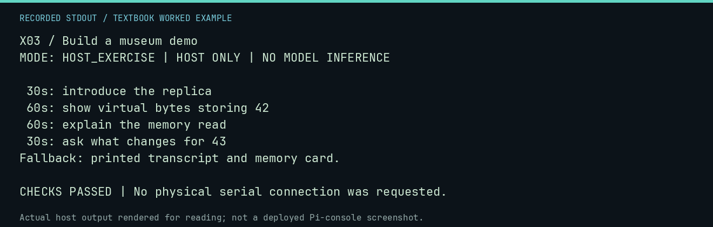

# X03 worked lab: Build a museum demo

[Lesson](README.md) · [Activity](ACTIVITY.md) · [Answers](ANSWERS.md) · [Source notes](SOURCE-NOTES.md)

**Goal:** Design a demonstration that works without the board.

**Mode:** `HOST_EXERCISE`. This companion runs on the host; it does not
change the original packet's paper activity or authorize physical Replica work.

## Understand the example

Choose one visible result, explain it, and ask the viewer a question. The timing below is a rehearsal plan. Code verifies the budget, not whether an audience learned the concept.

## Predict before running

Read the source below. Write down the expected printed values and the condition
that would make its checks fail. For a CPU trace, distinguish state before an
instruction from state after it. For a conceptual exercise, explain the rule
behind each classification rather than memorizing the printed label.

## Run it

From the checkout root with your environment active:

```bash
python -m tools.textbook run X03
```

The runner executes this [complete source](../../textbook/examples/X03.py):

```python
segments = [
    ("introduce the replica", 30),
    ("show virtual bytes storing 42", 60),
    ("explain the memory read", 60),
    ("ask what changes for 43", 30),
]
for topic, seconds in segments:
    print(f"{seconds:3d}s: {topic}")
assert sum(seconds for topic, seconds in segments) == 180
print("Fallback: printed transcript and memory card.")
```

## Recorded result

This output was actually executed and checked. The image is a readable render
of that stdout, not a screenshot of the deployed Pi console. A teaching fixture
or a host analogue is not independent historical or physical evidence.

```text
X03 / Build a museum demo
MODE: HOST_EXERCISE | HOST ONLY | NO MODEL INFERENCE

 30s: introduce the replica
 60s: show virtual bytes storing 42
 60s: explain the memory read
 30s: ask what changes for 43
Fallback: printed transcript and memory card.

CHECKS PASSED | No physical serial connection was requested.
```



[Raw output](../../textbook/captures/X03.txt) · [Capture manifest](../../textbook/captures/manifest.json)

## Change one thing

What should you ask the audience after presenting?

<details>
<summary>Compare your reasoning with the worked answer</summary>

Ask them to explain the one result in their own words. A timed script is not evidence of comprehension.

</details>

## Check your understanding

Explain the result without reading the code aloud. Name one condition that the
example did not test. Keep your prediction, changed input, actual output, and
interpretation together in your lab notebook. Use the linked textbook chapter
and the original source records for the broader context and evidence limits.

[Textbook home](../../textbook/README.md) · Previous: [X02: Fix the loop](../X02-fix-the-loop/WORKED.md) · Next: [X04: Curate a mini software exhibit](../X04-curate-a-mini-software-exhibit/WORKED.md)
