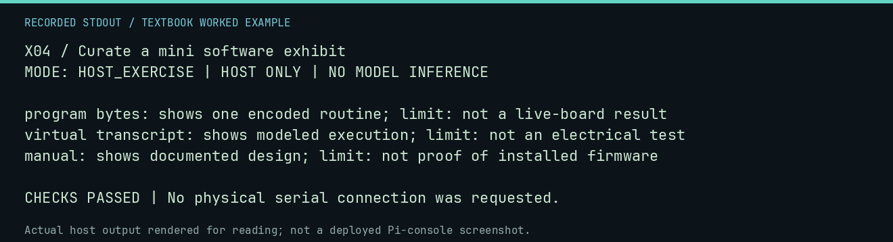

# X04 worked lab: Curate a mini software exhibit

[Lesson](README.md) · [Activity](ACTIVITY.md) · [Answers](ANSWERS.md) · [Source notes](SOURCE-NOTES.md)

**Goal:** Curate a set with explicit evidence limits.

**Mode:** `HOST_EXERCISE`. This companion runs on the host; it does not
change the original packet's paper activity or authorize physical Replica work.

## Understand the example

A useful exhibit connects an artifact, what it shows, and what it cannot prove. This exercise checks that every sample card states a limit; historical authenticity and rights still require source review.

## Predict before running

Read the source below. Write down the expected printed values and the condition
that would make its checks fail. For a CPU trace, distinguish state before an
instruction from state after it. For a conceptual exercise, explain the rule
behind each classification rather than memorizing the printed label.

## Run it

From the checkout root with your environment active:

```bash
python -m tools.textbook run X04
```

The runner executes this [complete source](../../textbook/examples/X04.py):

```python
cards = [
    ("program bytes", "one encoded routine", "not a live-board result"),
    ("virtual transcript", "modeled execution", "not an electrical test"),
    ("manual", "documented design", "not proof of installed firmware"),
]
for artifact, supports, limit in cards:
    print(f"{artifact}: shows {supports}; limit: {limit}")
assert all(limit for artifact, supports, limit in cards)
```

## Recorded result

This output was actually executed and checked. The image is a readable render
of that stdout, not a screenshot of the deployed Pi console. A teaching fixture
or a host analogue is not independent historical or physical evidence.

```text
X04 / Curate a mini software exhibit
MODE: HOST_EXERCISE | HOST ONLY | NO MODEL INFERENCE

program bytes: shows one encoded routine; limit: not a live-board result
virtual transcript: shows modeled execution; limit: not an electrical test
manual: shows documented design; limit: not proof of installed firmware

CHECKS PASSED | No physical serial connection was requested.
```



[Raw output](../../textbook/captures/X04.txt) · [Capture manifest](../../textbook/captures/manifest.json)

## Change one thing

What strengthens the exhibit more: a confident caption or a precise source record?

<details>
<summary>Compare your reasoning with the worked answer</summary>

A precise source record lets a reviewer evaluate the caption. Confidence supplies no additional evidence.

</details>

## Check your understanding

Explain the result without reading the code aloud. Name one condition that the
example did not test. Keep your prediction, changed input, actual output, and
interpretation together in your lab notebook. Use the linked textbook chapter
and the original source records for the broader context and evidence limits.

[Textbook home](../../textbook/README.md) · Previous: [X03: Build a museum demo](../X03-build-a-museum-demo/WORKED.md) · Next: [X05: Invent the next lesson](../X05-invent-the-next-lesson/WORKED.md)
