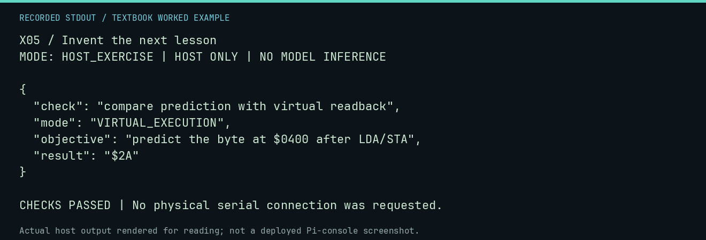

# X05 worked lab: Invent the next lesson

[Lesson](README.md) · [Activity](ACTIVITY.md) · [Answers](ANSWERS.md) · [Source notes](SOURCE-NOTES.md)

**Goal:** Write an observable learning objective.

**Mode:** `HOST_EXERCISE`. This companion runs on the host; it does not
change the original packet's paper activity or authorize physical Replica work.

## Understand the example

"Understand assembly" does not specify how learning is checked. An objective should name a task, visible output, and criterion. A completed author card is a proposal requiring review, not a new approved curriculum item.

## Predict before running

Read the source below. Write down the expected printed values and the condition
that would make its checks fail. For a CPU trace, distinguish state before an
instruction from state after it. For a conceptual exercise, explain the rule
behind each classification rather than memorizing the printed label.

## Run it

From the checkout root with your environment active:

```bash
python -m tools.textbook run X05
```

The runner executes this [complete source](../../textbook/examples/X05.py):

```python
from tools.textbook_support import emit

proposal = {
    "objective": "predict the byte at $0400 after LDA/STA",
    "result": "$2A",
    "check": "compare prediction with virtual readback",
    "mode": "VIRTUAL_EXECUTION",
}
emit(proposal)
assert all(proposal.values())
```

## Recorded result

This output was actually executed and checked. The image is a readable render
of that stdout, not a screenshot of the deployed Pi console. A teaching fixture
or a host analogue is not independent historical or physical evidence.

```text
X05 / Invent the next lesson
MODE: HOST_EXERCISE | HOST ONLY | NO MODEL INFERENCE

{
  "check": "compare prediction with virtual readback",
  "mode": "VIRTUAL_EXECUTION",
  "objective": "predict the byte at $0400 after LDA/STA",
  "result": "$2A"
}

CHECKS PASSED | No physical serial connection was requested.
```



[Raw output](../../textbook/captures/X05.txt) · [Capture manifest](../../textbook/captures/manifest.json)

## Change one thing

How would you assess an open-ended program design?

<details>
<summary>Compare your reasoning with the worked answer</summary>

Use a rubric covering requirements, memory ranges, reachable exit, tests including boundaries, source notes, and an honest limit statement.

</details>

## Check your understanding

Explain the result without reading the code aloud. Name one condition that the
example did not test. Keep your prediction, changed input, actual output, and
interpretation together in your lab notebook. Use the linked textbook chapter
and the original source records for the broader context and evidence limits.

[Textbook home](../../textbook/README.md) · Previous: [X04: Curate a mini software exhibit](../X04-curate-a-mini-software-exhibit/WORKED.md) · Next: [SP01: Two Boards, One Computer](../SP01-two-boards-one-computer/WORKED.md)
