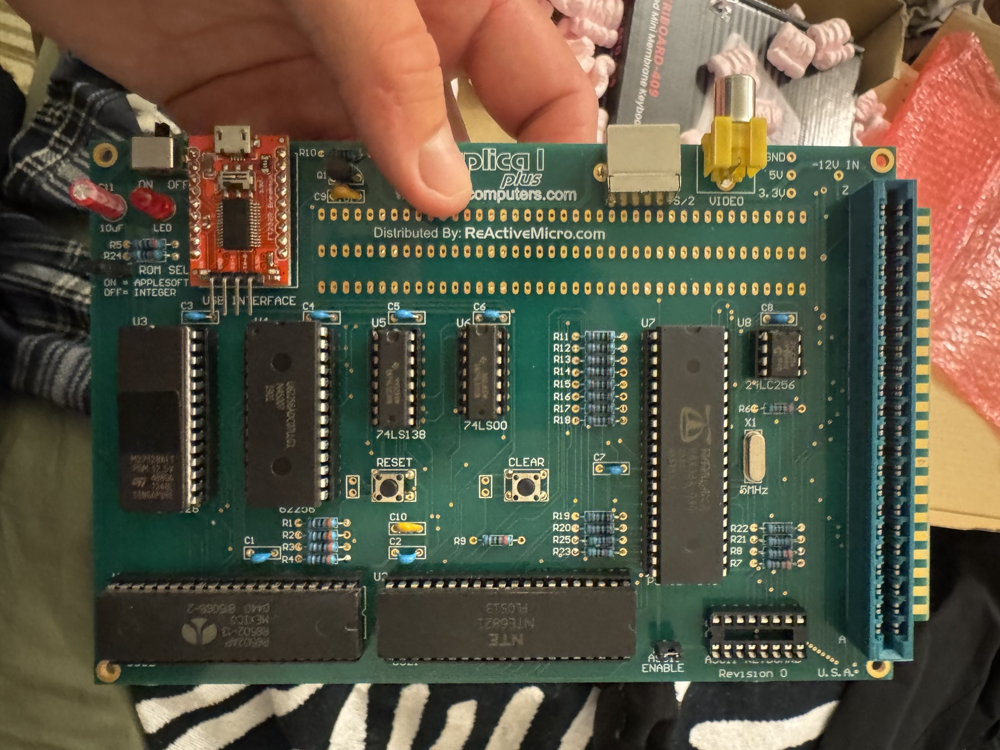

# Repair context recovered on October 28, 2026

[Current bounded repair plan](../replica-repair-plan.md) ·
[Repair issue #17](https://github.com/SquirmyWormy275/apple1/issues/17)

This register reconciles accessible chat history with actual repository artifacts.
It separates measured results, later decisions and work that was only promised.
The public record is self-contained; private chat links are provenance aids and
may require the owner's account. Full mixed-purpose transcripts stay private.

**Subsequent software staging:** the [recovery package](../../../firmware/recovery/110REV03-2026-10-28/README.md)
is now built and verified off-device. Statements below about an unlocated
compiled package describe the earlier history audit, not the current software
state. Live recovery and physical compatibility remain pending.

## Coverage and access limits

- Enumerated the **16 conversations visible in the Apple1 ChatGPT project** and
  read accessible conversation windows, including earlier windows of the primary
  repair discussions. Captured rendered text locally; recovered eight supplied
  photographs from **Measure Propeller Reset**. Long conversations use virtualized
  windows; these snapshots are not a certified complete message-by-message export.
- Used account history searches for **Apple1**, **FT232R** and **Propeller** to
  check beyond the project. Repair hits led back to these conversations; incidental
  branding/workstation results did not establish additional bench evidence.
- Scanned **350 locally available Codex rollout files** against the 349-thread
  local index, including user/assistant messages and related implementation
  rollouts. **17 keyword candidates** were reviewed: nine principal project/context
  threads, three related implementation rollouts and five incidental mentions.
  No JSON parse errors were recorded. Hidden reasoning was not extracted.
- Checked current `main`, preserved capture packets, firmware/provenance tools,
  GitHub issues/PRs and the separate PR #6 checkout/local preparation records.
  The parallel repository/documentation session was consulted for coordination.
- Local, dated scan manifests and extracted history are retained privately under
  `~/.local/state/apple1-repair-context/20261028/`. They are collection-time
  snapshots, not an export of every chat on every device or service.

Deleted chats, unexposed cloud-only Codex tasks, earlier inaccessible conversation
windows and inaccessible external video bytes cannot be certified complete.
No verified account-wide ChatGPT export was available. This register does not
claim those inaccessible sources were scraped. A later export can extend the
ledger without reopening completed hardware experiments.

## ChatGPT source register

| Conversation | Repair relevance / disposition |
|---|---|
| [Review dimensions source_truth](https://chatgpt.com/g/g-p-6a93cddd65488191a63102d059247d1f/c/6ab07b2d-c83c-83e8-a7fb-d1bd4f59c100) | R04 enclosure reference supersedes earlier dimensional proposals; fitting assumptions remain. No new electrical result. |
| [Polish repo request](https://chatgpt.com/g/g-p-6a93cddd65488191a63102d059247d1f/c/6aab720c-5dc0-83e8-bf84-79afaa724233) | Source/navigation cleanup merged; PR #6 remained the distinct unqualified hardware-preparation workstream. |
| [Build Shopping List](https://chatgpt.com/g/g-p-6a93cddd65488191a63102d059247d1f/c/6aa5dc94-dbcc-83e8-bf7d-f9e16a0544c0) | Later controlling repair decision: bounded time/cost, no scope purchase, power sanity check then compatible firmware/spare EEPROM; optional P1 substitution, then vendor repair/replacement. |
| [Measure Propeller Reset](https://chatgpt.com/g/g-p-6a93cddd65488191a63102d059247d1f/c/6aa39669-e118-83e8-8599-8f5e2206c544) | Primary supplied hardware photographs; reset/power preparation and later firmware/persistent-port proposals. Promised deliverables and a stalled work indicator are not proof of a compiled package or live repair. |
| [Configure NEURAL1 Overnight](https://chatgpt.com/g/g-p-6a93cddd65488191a63102d059247d1f/c/6aa2519e-4414-83e8-9818-8e0fe950a280) | Pi application commissioning complete for its recorded release; preserve installed software/SSD. No physical serial acceptance. |
| [SATA Pi Compatibility Check](https://chatgpt.com/g/g-p-6a93cddd65488191a63102d059247d1f/c/6aa21ed7-7ab0-83e8-a523-68f804d924fb) | Earlier tray, OLED and mounting proposals; do not mistake planned accessories or fit dimensions for measured/installed equipment. |
| [Retro Interior Ideas](https://chatgpt.com/g/g-p-6a93cddd65488191a63102d059247d1f/c/6aa25bd5-7a94-83e8-9d73-594723e2a9b2) | Appearance ideas only; generated interior renderings do not identify real wiring or component state. |
| [SATA Pi Adapter Comparison](https://chatgpt.com/g/g-p-6a93cddd65488191a63102d059247d1f/c/6aa21ea6-7d68-83e8-986b-a3817befff31) | Adapter shopping discussion; no repair measurement. Later commissioned NVMe setup supersedes old acquisition questions. |
| [Connect Replica To Sanyo](https://chatgpt.com/g/g-p-6a93cddd65488191a63102d059247d1f/c/6a99d846-7c0c-83e8-ab7a-e47565096df5) | Sanyo cable/connector and termination planning. Preserve the existing display for the first repair comparison. |
| [Logic Analyzer Setup](https://chatgpt.com/g/g-p-6a93cddd65488191a63102d059247d1f/c/6a96401b-f5c8-83e8-b7ef-055d2db564a3) | September 2 experiment and follow-on reset/power hypotheses. Scope-first economic strategy was revised by the later shopping conversation. |
| [Repository consolidation report](https://chatgpt.com/g/g-p-6a93cddd65488191a63102d059247d1f/c/6a950454-b6d8-83e8-81f5-ed3db2cb9328) | Repository/Pi-image preservation closeout; candidate firmware is not installed-image proof. Later Pi commissioning supersedes early missing-model/SSD statements. |
| [Design Pi LLM Modes](https://chatgpt.com/g/g-p-6a93cddd65488191a63102d059247d1f/c/6a94c0d0-6de0-83e8-a196-965236a83535) | NEURAL1 modes and implementation handoffs. Early model-presence claims must be checked against image archaeology and the later completed Pi deployment. |
| [Sanyo VM 4209 Score](https://chatgpt.com/g/g-p-6a93cddd65488191a63102d059247d1f/c/6a94ed1b-8f3c-83e8-83fa-1f55c5c18077) | Sanyo collection/history and manual discussion; no demonstrated repair of the Replica serial path. |
| [Used SSD Deal Watch](https://chatgpt.com/g/g-p-6a93cddd65488191a63102d059247d1f/c/6a94fe5d-9ba4-83e8-a93e-9abaacd30493) | Older SSD/NEURAL1 planning and physical-boundary prompts; later commissioning controls current installed status. |
| [Architecture layout](https://chatgpt.com/g/g-p-6a93cddd65488191a63102d059247d1f/c/6a93d045-e6f4-83e8-914e-8d65f199b08e) | Architecture/teaching/source organization. Drawn board reconstructions do not replace historical photographs or continuity measurements. |
| [Find Apple 1 Chats](https://chatgpt.com/g/g-p-6a93cddd65488191a63102d059247d1f/c/6a93cd0a-9840-83e8-ae60-d56d884aebf7) | Early project-context inventory and hypotheses. Its claimed 18 uploaded conversation chunks could not be verified and the supposed archive lead was corrected below. |

## Codex source register

Thread IDs allow the next agent to find the original local task rather than
mistaking a pasted ChatGPT handoff for execution evidence.

| Date / subject | Thread ID | What it contributes |
|---|---|---|
| Aug 30 — NEURAL1 foundation | `01a05597-6ba8-7333-9889-bc57f27f38fc` | Off-device architecture and explicit physical boundary. |
| Aug 30 — preserve existing Pi | `01a05631-90a4-70a1-9bbe-aa3889509b47` | Preservation and image inspection; avoid unnecessary reinstalls. |
| Aug 30 — Pi image archaeology | `01a05678-a93a-77e0-affb-a18177937a1c` | Actual recovered image contents supersede earlier assumed model inventory. |
| Sep 2 — capture closeout, titled SHA-256 | `01a0636d-87b6-7cb0-9598-8a84419c61cd` | Completed capture status, immutable evidence, corrected validation claims. |
| Sep 9 — read-only SD/SSD inspection | `01a08a14-277d-7cb2-8c2a-647c2b9ac30b` | Pre-commissioning inventory, not serial acceptance. |
| Sep 10 — finish runnable Pi | `01a08a30-9bc3-7df0-805d-0dd7df73402e` | Actual application/SSD commissioning and limitations. |
| Sep 10–11 — prepare P1/Pi Propeller job | `01a08f39-3335-7f53-895b-d14ca153e5b1` | Host/Pi/analyzer preparation eventually completed; physical probe qualification and new event did not. |
| Oct 27–28 — repository/textbook review | `01a17f6d-c3bf-7642-b332-fa4465bb86d3` | Parallel documentation work, current teaching/CI evidence; no electrical repair. |
| Oct 27–28 — CF audit and this consolidation | `01a1812b-4736-7ca2-92a4-461b79e46af3` | Verified CF write/readback, handoff and this repair register; no new serial action. |

Three associated September 10 implementation rollouts were also reviewed:
`01a08a31-42ca-77b3-b4bd-12eb4bb110ac`,
`01a08a31-58e4-7282-ac1c-8a228327ca9f`, and
`01a08a31-6d8b-7031-9774-80ac383d716d`.
Five remaining keyword candidates concerned general workstation/review activity;
they contributed no separate Replica bench result.

## Reconciled timeline and corrections

| Record | What controls now |
|---|---|
| Aug 27 no-transmit open | Display corruption occurred without payload; physical Reset restored stable Monitor/cursor. Cause unproved. |
| Sep 2 analyzer experiment | Execution **COMPLETE**, root cause **INCONCLUSIVE**, packet **COMPLETE_WITH_EXTERNAL_MEDIA**, media portability **NOT_SELF_CONTAINED_MEDIA**. The one event is spent; incomplete root cause does not mean incomplete execution. |
| Sep 2 four-conductor finding | Applies to that documented interconnect. Later schematic/multi-position mounting photographs require reconciliation before declaring all DTR/reset coupling absent. |
| Sep 2 screen and test-count claims | Reset restored a cursor with stale garbage; CLEAR was not pressed. Local closeout corrected the old 123-pass/pre-existing-failure claim: 125 collected, 124 passed/1 failed, and the clean base passed the provenance test. Do not repeat the old assertion. Later source-format/CI work is separate. |
| Sep 10 Pi closeout | Runnable Pi, model/SSD and startup evidence already exist. Early absent-model/unfinished-SSD statements are historical. Preserve the accepted installation. |
| Sep 11 analyzer preparation | Initial `out/readiness.json`/local-readiness prose said absent; later `out/setup-record.md` and task closeout detected `0925:3881`, fx2lafw D0–D7, 4 MS/s. The USB-A–USB-C cable issue was resolved. Rediscover present identity without restarting the same generic cable loop. |
| Sep 11 runner and firmware promises | PR #6 contains actual bounded runner/simulators and host/Pi preparation, not a qualified physical capture. No verified compiled firmware/uploader/rollback package was located in main or the inspected preparation worktree. |
| Sep 12–13 repair decision | Later user-accepted bounded strategy supersedes an obligatory scope/root-cause campaign. Preserve original EEPROM; try compatible recovery/spare, at most one justified additional substitution, then vendor repair/replacement. |
| Oct 28 recovered photographs | Earlier assertions that there were no available board photographs are obsolete. Eight historical JPEGs are now retained below. They do not establish today's continuity or rails. |
| Oct 28 CF closeout | Media installation and checksum readback are complete. Physical Replica acceptance remains #15; electrical/serial restoration is #17. Neither is evidence of the other. |

**Correction to the export lead:** **Find Apple 1 Chats** claimed 18 uploaded
`conversations-001.json` through `conversations-018.json` files. Account search
led to **Map Agentic Workflows**, whose underlying discussion was a **Claude**
export. Its conversation-file split attempt failed because the script was
missing; no successful 18-chunk upload was verified. No matching local export
files were located. Do not repeat the earlier claim as an established archive.
No unrelated private export contents are published here.

## Recovered hardware photographs

These are the eight distinct user attachments recoverable from **Measure
Propeller Reset**. They are unchanged ChatGPT-delivered JPEG renditions;
camera-original identity, photographer and original capture timestamps are not
independently established. No claim is made that an older promise to preserve
“ten originals” was fulfilled. The [manifest](photo-manifest.json) records exact
bytes, SHA-256, source, retrieval method and limitations.

| Photograph | Visible evidence |
|---|---|
| [Board overview](photos/board-overview.jpg) | Revision 0 silkscreen, ReActiveMicro branding, reset/clear controls and installed USB module. |
| [Propeller close-up](photos/propeller-closeup.jpg) | P8X32A-D40 marking, orientation and nearby EEPROM. |
| [Powered board](photos/powered-board.jpg) | Historical powered top view and Q1/C9/R10 area. |
| [CFFA1 and CF](photos/cffa1-card.jpg) | CFFA1 marked 22 and inserted Lexar card. |
| [Alternate top view](photos/board-alternate.jpg) | Board/component layout and connector arrangement. |
| [Rear connectors](photos/rear-connectors.jpg) | Composite video and PS/2 connector profile. |
| [USB module side](photos/usb-module-side.jpg) | Module mounting height and interconnect side view. |
| [Board underside](photos/board-underside.jpg) | Solder connections and ReActiveMicro 2026 sticker. |

Photographs establish visible objects and markings, not current topology,
continuity, installed EEPROM contents, voltages or qualified probe points.
Use them to avoid repeating identification work; obtain only a specifically
missing/current view if the setup has changed.

## Repository and manufacturer anchors

- [Troubleshooting observations](../../troubleshooting.md),
  [September 2 evidence packet](../../captures/2026-09-02-ft232r-open-analyzer/README.md)
  and [serial characterization protocol](../../serial-test-protocol.md).
- [Firmware candidate](../../firmware-baseline.md),
  [static audit](../../firmware-static-audit.md) and
  [recovery ledger](../../recovery-evidence-ledger.md). Candidate provenance is
  strong; installed-image identity and a usable recovery package remain distinct.
- [PR #6 preparation](https://github.com/SquirmyWormy275/apple1/pull/6), inspected
  at `6d644d26425e8f62e48b9627b1c56430be144cbc`; includes reset/power reference,
  next-session card, worker/handoff and simulations. Local `out/` records supply
  the later enumeration correction; they are not a new physical trace.
- [ReActiveMicro Replica documentation](https://wiki.reactivemicro.com/Replica_1),
  checked October 28. Programming/selector and published noise remedies require
  revision/symptom matching; they are not diagnoses of this unit.
- [Revision 0 schematic reference](http://retro.hansotten.nl/uploads/apple1/r1plus%20schematics.pdf),
  identified in PR #6 as dated March 29, 2014, SHA-256
  `dbd707582e00d98be685e69e6c7640ae28edc1e32074778976de98f496860dbe`.
  The drawing includes DTR→C9→Q1→RST. Confirm the fitted route electrically.
- [Parallax-authored P8X32A datasheet v1.4](https://tecnoedu.com/Download/Propeller-P8X32A-Datasheet-v1.4.0.pdf),
  the D40 pinout reference identified in PR #6, SHA-256
  `c160519a8012990485803a4af8f2be8dde8c155725478f152f7e658121638550`.
- [SparkFun TOL-18627](https://www.sparkfun.com/usb-logic-analyzer-24mhz-8-channel.html)
  specifications and ground guidance, checked October 28. Digital traces do not
  measure analog rail amplitude.

**Next agent:** start with the [bounded plan](../replica-repair-plan.md), prepare
actual recovery artifacts off-device, inventory the already-planned tools, then
use a single recorded bench session. Do not restart Pi provisioning, rewrite
the installed CF edition, ask for the same eight photographs, or treat an old
chat's promise as proof of completed firmware work.
