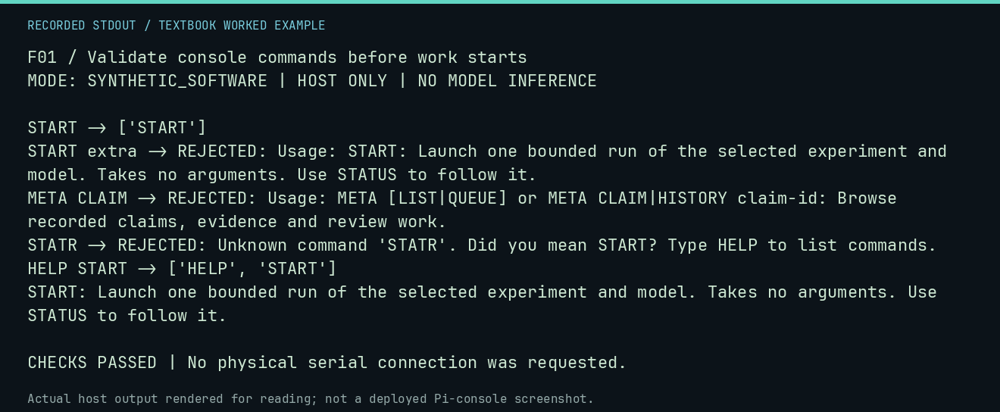

# F01 worked lab: Validate console commands before work starts

**Goal:** Validate console commands before work starts.

**Mode:** `SYNTHETIC_SOFTWARE`. This companion runs on the host; it does not
change the original packet's paper activity or authorize physical Replica work.

## Understand the example

The parser validates syntax before the application checks storage or launches a worker. A suggested correction is advice, not an automatically executed command. This lab exercises the real parser without a deployment configuration.

## Predict before running

Read the source below. Write down the expected printed values and the condition
that would make its checks fail. For a CPU trace, distinguish state before an
instruction from state after it. For a conceptual exercise, explain the rule
behind each classification rather than memorizing the printed label.

## Run it

From the checkout root with your environment active:

```bash
python -m tools.textbook run F01
```

The runner executes this [complete source](../examples/F01.py):

```python
from neural1.console_ui import command_help, parse_command
from neural1.core import Neural1Error

for command in ("START", "START extra", "META CLAIM", "STATR", "HELP START"):
    try:
        print(command, "->", parse_command(command))
    except Neural1Error as error:
        print(command, "-> REJECTED:", error)
assert parse_command("HELP START") == ["HELP", "START"]
print(command_help("START"))
```

## Recorded result

This output was actually executed and checked. The image is a readable render
of that stdout, not a screenshot of the deployed Pi console. A teaching fixture
or a host analogue is not independent historical or physical evidence.

```text
F01 / Validate console commands before work starts
MODE: SYNTHETIC_SOFTWARE | HOST ONLY | NO MODEL INFERENCE

START -> ['START']
START extra -> REJECTED: Usage: START: Launch one bounded run of the selected experiment and model. Takes no arguments. Use STATUS to follow it.
META CLAIM -> REJECTED: Usage: META [LIST|QUEUE] or META CLAIM|HISTORY claim-id: Browse recorded claims, evidence and review work.
STATR -> REJECTED: Unknown command 'STATR'. Did you mean START? Type HELP to list commands.
HELP START -> ['HELP', 'START']
START: Launch one bounded run of the selected experiment and model. Takes no arguments. Use STATUS to follow it.

CHECKS PASSED | No physical serial connection was requested.
```



[Raw output](../captures/F01.txt) · [Capture manifest](../captures/manifest.json)

## Change one thing

Why must START extra be rejected rather than ignored?

<details>
<summary>Compare your reasoning with the worked answer</summary>

The extra argument may express an assumption about what will run. Ignoring it can start unintended work.

</details>

## Check your understanding

Explain the result without reading the code aloud. Name one condition that the
example did not test. Keep your prediction, changed input, actual output, and
interpretation together in your lab notebook. Use the linked textbook chapter
and the original source records for the broader context and evidence limits.

[Textbook home](../README.md) · Previous: [SP01: Two Boards, One Computer](../../field-library/SP01-two-boards-one-computer/WORKED.md) · Next: [F02: Assemble source and retain its execution trace](F02.md)
