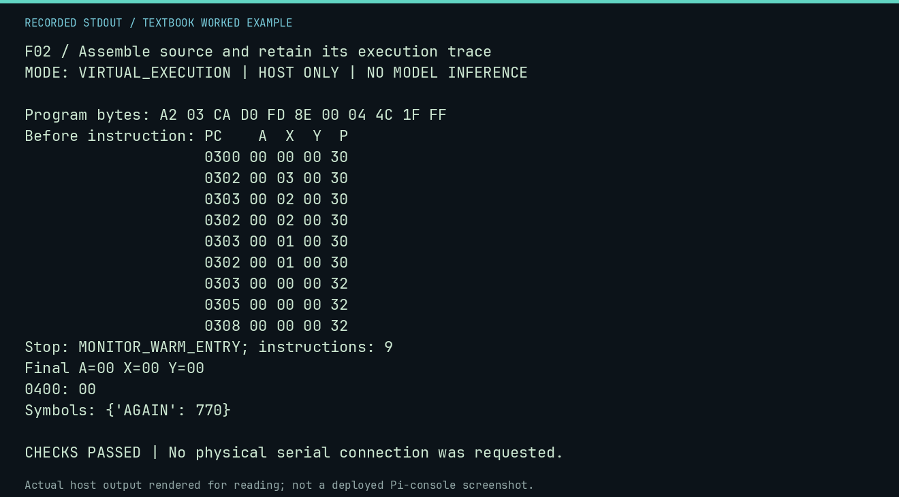

# F02 worked lab: Assemble source and retain its execution trace

**Goal:** Assemble source and retain its execution trace.

**Mode:** `VIRTUAL_EXECUTION`. This companion runs on the host; it does not
change the original packet's paper activity or authorize physical Replica work.

## Understand the example

The lesson assembler performs two passes so a branch can refer to a later label. This is host-side teaching tooling. The constrained experimental agent does not receive this assembler API as an extra tool.

## Predict before running

Read the source below. Write down the expected printed values and the condition
that would make its checks fail. For a CPU trace, distinguish state before an
instruction from state after it. For a conceptual exercise, explain the rule
behind each classification rather than memorizing the printed label.

## Run it

From the checkout root with your environment active:

```bash
python -m tools.textbook run F02
```

The runner executes this [complete source](../examples/F02.py):

```python
from tools.textbook_support import cpu

w, r, a = cpu("LDX #$03\nAGAIN: DEX\nBNE AGAIN\nSTX $0400\nJMP $FF1F", trace=True)
print("Symbols:", a.symbols)
assert r.final_x == 0 and a.symbols["AGAIN"] == 0x302
```

## Recorded result

This output was actually executed and checked. The image is a readable render
of that stdout, not a screenshot of the deployed Pi console. A teaching fixture
or a host analogue is not independent historical or physical evidence.

```text
F02 / Assemble source and retain its execution trace
MODE: VIRTUAL_EXECUTION | HOST ONLY | NO MODEL INFERENCE

Program bytes: A2 03 CA D0 FD 8E 00 04 4C 1F FF
Before instruction: PC    A  X  Y  P
                    0300 00 00 00 30
                    0302 00 03 00 30
                    0303 00 02 00 30
                    0302 00 02 00 30
                    0303 00 01 00 30
                    0302 00 01 00 30
                    0303 00 00 00 32
                    0305 00 00 00 32
                    0308 00 00 00 32
Stop: MONITOR_WARM_ENTRY; instructions: 9
Final A=00 X=00 Y=00
0400: 00
Symbols: {'AGAIN': 770}

CHECKS PASSED | No physical serial connection was requested.
```



[Raw output](../captures/F02.txt) · [Capture manifest](../captures/manifest.json)

## Change one thing

Can you infer physical clock timing from the trace instruction count?

<details>
<summary>Compare your reasoning with the worked answer</summary>

No. The bounded software trace is not an electrical or cycle-accurate Replica measurement.

</details>

## Check your understanding

Explain the result without reading the code aloud. Name one condition that the
example did not test. Keep your prediction, changed input, actual output, and
interpretation together in your lab notebook. Use the linked textbook chapter
and the original source records for the broader context and evidence limits.

[Textbook home](../README.md) · Previous: [F01: Validate console commands before work starts](F01.md) · Next: [F03: Record a provider response and replay its exact identity](F03.md)
