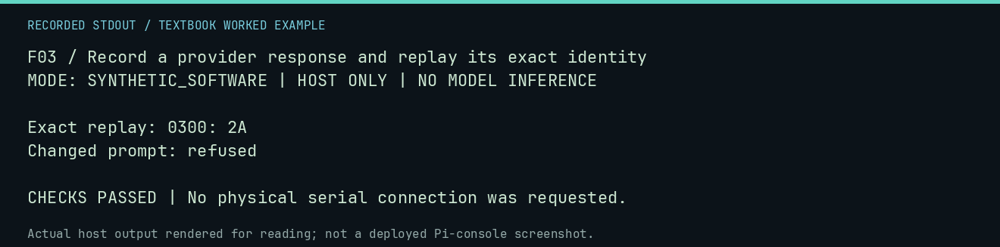

# F03 worked lab: Record a provider response and replay its exact identity

**Goal:** Record a provider response and replay its exact identity.

**Mode:** `SYNTHETIC_SOFTWARE`. This companion runs on the host; it does not
change the original packet's paper activity or authorize physical Replica work.

## Understand the example

A recording binds a response to its prompt, agent, and seed. Exact replay must refuse a missing tuple rather than supply a plausible replacement. The provider below is deliberately fake, so this tests recording behavior without inference.

## Predict before running

Read the source below. Write down the expected printed values and the condition
that would make its checks fail. For a CPU trace, distinguish state before an
instruction from state after it. For a conceptual exercise, explain the rule
behind each classification rather than memorizing the printed label.

## Run it

From the checkout root with your environment active:

```bash
python -m tools.textbook run F03
```

The runner executes this [complete source](../examples/F03.py):

```python
from pathlib import Path
from tempfile import TemporaryDirectory

from neural1.core import Neural1Error
from neural1.models import FakeProvider, RecordingProvider

with TemporaryDirectory() as d:
    provider = RecordingProvider(FakeProvider(default="0300: 2A"), Path(d) / "record.jsonl")
    actual = provider.generate("INSPECT", agent_id="A", seed=7)
    replay = RecordingProvider.load_replay(Path(d) / "record.jsonl")
    assert replay.generate("INSPECT", agent_id="A", seed=7) == actual
    print("Exact replay:", actual.text)
    try:
        replay.generate("OTHER PROMPT", agent_id="A", seed=7)
        raise AssertionError("missing replay must fail")
    except Neural1Error:
        print("Changed prompt: refused")
```

## Recorded result

This output was actually executed and checked. The image is a readable render
of that stdout, not a screenshot of the deployed Pi console. A teaching fixture
or a host analogue is not independent historical or physical evidence.

```text
F03 / Record a provider response and replay its exact identity
MODE: SYNTHETIC_SOFTWARE | HOST ONLY | NO MODEL INFERENCE

Exact replay: 0300: 2A
Changed prompt: refused

CHECKS PASSED | No physical serial connection was requested.
```



[Raw output](../captures/F03.txt) · [Capture manifest](../captures/manifest.json)

## Change one thing

Would fixing only the random seed reproduce a different model build?

<details>
<summary>Compare your reasoning with the worked answer</summary>

No. Preserve weights/manifest identity, configuration, prompt, runtime, and recordings. A seed is only one input.

</details>

## Check your understanding

Explain the result without reading the code aloud. Name one condition that the
example did not test. Keep your prediction, changed input, actual output, and
interpretation together in your lab notebook. Use the linked textbook chapter
and the original source records for the broader context and evidence limits.

[Textbook home](../README.md) · Previous: [F02: Assemble source and retain its execution trace](F02.md) · Next: [F04: Qualify a test model registry without downloading weights](F04.md)
