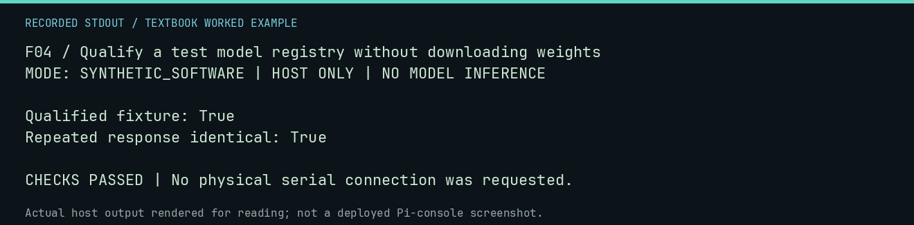

# F04 worked lab: Qualify a test model registry without downloading weights

**Goal:** Qualify a test model registry without downloading weights.

**Mode:** `SYNTHETIC_SOFTWARE`. This companion runs on the host; it does not
change the original packet's paper activity or authorize physical Replica work.

## Understand the example

A registry identifies the backend, exact model, context bound, settings, and provenance. Qualification checks a bounded provider configuration. This fake record is marked TEST-ONLY; its qualification is not native Ollama model acceptance.

## Predict before running

Read the source below. Write down the expected printed values and the condition
that would make its checks fail. For a CPU trace, distinguish state before an
instruction from state after it. For a conceptual exercise, explain the rule
behind each classification rather than memorizing the printed label.

## Run it

From the checkout root with your environment active:

```bash
python -m tools.textbook run F04
```

The runner executes this [complete source](../examples/F04.py):

```python
from pathlib import Path
from tempfile import TemporaryDirectory

from neural1.qualification import qualify_registry
from neural1.registry import ModelRegistry, RegisteredModel

registry = ModelRegistry()
registry.add(
    RegisteredModel(
        "fake", "fixture", "test", "fake", "fake-v1", "0", "NONE", 512, "fixture", "TEST-ONLY", {"default": "0200: 00", "max_tokens": 8}
    )
)
with TemporaryDirectory() as d:
    path = Path(d) / "registry.json"
    registry.save(path)
    result = qualify_registry(path, Path(d) / "qualification.json")
    print("Qualified fixture:", result["qualified"])
    print("Repeated response identical:", result["results"][0]["repeat_identical"])
    assert result["qualified"] and result["results"][0]["repeat_identical"]
```

## Recorded result

This output was actually executed and checked. The image is a readable render
of that stdout, not a screenshot of the deployed Pi console. A teaching fixture
or a host analogue is not independent historical or physical evidence.

```text
F04 / Qualify a test model registry without downloading weights
MODE: SYNTHETIC_SOFTWARE | HOST ONLY | NO MODEL INFERENCE

Qualified fixture: True
Repeated response identical: True

CHECKS PASSED | No physical serial connection was requested.
```



[Raw output](../captures/F04.txt) · [Capture manifest](../captures/manifest.json)

## Change one thing

What must replace placeholder metadata before a real campaign?

<details>
<summary>Compare your reasoning with the worked answer</summary>

Locally observed model identities, digests, quantization, context/settings, license, and provenance information.

</details>

## Check your understanding

Explain the result without reading the code aloud. Name one condition that the
example did not test. Keep your prediction, changed input, actual output, and
interpretation together in your lab notebook. Use the linked textbook chapter
and the original source records for the broader context and evidence limits.

[Textbook home](../README.md) · Previous: [F03: Record a provider response and replay its exact identity](F03.md) · Next: [F05: Cancel and resume without duplicating committed turns](F05.md)
