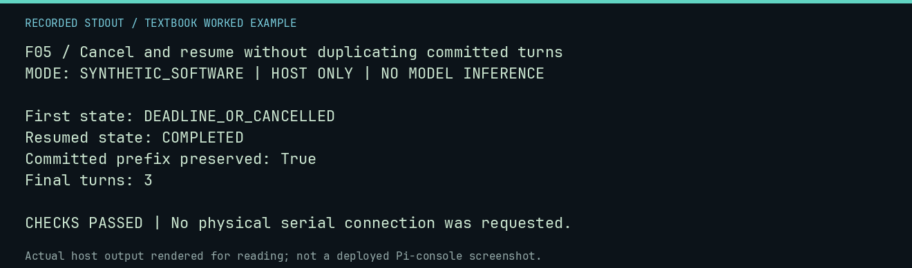

# F05 worked lab: Cancel and resume without duplicating committed turns

**Goal:** Cancel and resume without duplicating committed turns.

**Mode:** `SYNTHETIC_SOFTWARE`. This companion runs on the host; it does not
change the original packet's paper activity or authorize physical Replica work.

## Understand the example

A checkpoint is useful when an interrupted run resumes with its earlier transcript intact. The synthetic provider requests cancellation after its first call. Resume uses the actual campaign engine and the same specification, without a systemd worker or a live model.

## Predict before running

Read the source below. Write down the expected printed values and the condition
that would make its checks fail. For a CPU trace, distinguish state before an
instruction from state after it. For a conceptual exercise, explain the rule
behind each classification rather than memorizing the printed label.

## Run it

From the checkout root with your environment active:

```bash
python -m tools.textbook run F05
```

The runner executes this [complete source](../examples/F05.py):

```python
from pathlib import Path
from tempfile import TemporaryDirectory

from neural1.campaign import CampaignEngine, CampaignSpec
from neural1.models import FakeProvider
from neural1.registry import ModelRegistry, RegisteredModel

registry = ModelRegistry()
registry.add(RegisteredModel("fake", "fixture", "test", "fake", "fake-v1", "0", "NONE", 512, "fixture", "TEST-ONLY", {}))
spec = CampaignSpec.create(
    experiments=["4k-mind"],
    model_ids=["fake"],
    seeds=[7],
    generations=3,
    agents_per_cell=1,
    ram_budget=1024,
    max_tokens=32,
    generation_settings={},
    matched_control="fixed fixture",
    wall_clock_limit_seconds=20,
)
with TemporaryDirectory() as d:

    class Pausing(FakeProvider):
        def generate(self, prompt, *, agent_id, seed):
            result = super().generate(prompt, agent_id=agent_id, seed=seed)
            engine.cancel(spec.campaign_id)
            return result

    engine = CampaignEngine(d, registry, {"fake": Pausing(default="0200: 2A")})
    first = engine.run(spec, objective_factory=lambda c, g: "DEPOSIT", command_parser=lambda s: [s])
    transcript = next((Path(d) / "campaigns").rglob("transcript.jsonl"))
    prefix = transcript.read_bytes()
    resumed = CampaignEngine(d, registry, {"fake": FakeProvider(default="0200: 2A")}).resume(
        spec, objective_factory=lambda c, g: "DEPOSIT", command_parser=lambda s: [s]
    )
    print("First state:", first.status)
    print("Resumed state:", resumed.status)
    print("Committed prefix preserved:", transcript.read_bytes().startswith(prefix))
    print("Final turns:", len(transcript.read_text().splitlines()))
    assert resumed.status == "COMPLETED" and transcript.read_bytes().startswith(prefix)
    assert len(transcript.read_text().splitlines()) == 3
```

## Recorded result

This output was actually executed and checked. The image is a readable render
of that stdout, not a screenshot of the deployed Pi console. A teaching fixture
or a host analogue is not independent historical or physical evidence.

```text
F05 / Cancel and resume without duplicating committed turns
MODE: SYNTHETIC_SOFTWARE | HOST ONLY | NO MODEL INFERENCE

First state: DEADLINE_OR_CANCELLED
Resumed state: COMPLETED
Committed prefix preserved: True
Final turns: 3

CHECKS PASSED | No physical serial connection was requested.
```



[Raw output](../captures/F05.txt) · [Capture manifest](../captures/manifest.json)

## Change one thing

What would invalidate a same-ID resume?

<details>
<summary>Compare your reasoning with the worked answer</summary>

Changing the canonical specification or losing the original effective model registry undermines the meaning of continuing the same run.

</details>

## Check your understanding

Explain the result without reading the code aloud. Name one condition that the
example did not test. Keep your prediction, changed input, actual output, and
interpretation together in your lab notebook. Use the linked textbook chapter
and the original source records for the broader context and evidence limits.

[Textbook home](../README.md) · Previous: [F04: Qualify a test model registry without downloading weights](F04.md) · Next: [F06: Verify an export and detect changed evidence](F06.md)
