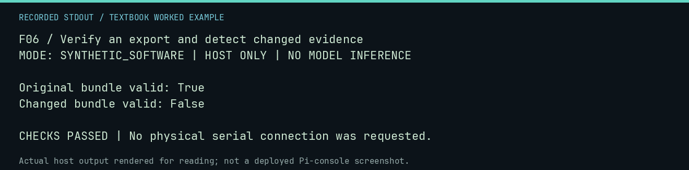

# F06 worked lab: Verify an export and detect changed evidence

**Goal:** Verify an export and detect changed evidence.

**Mode:** `SYNTHETIC_SOFTWARE`. This companion runs on the host; it does not
change the original packet's paper activity or authorize physical Replica work.

## Understand the example

Export creates a separate evidence package with a file manifest. Verification detects content changes. A correct hash does not prove that a scientific interpretation is correct, but a changed hash can invalidate a claim of unchanged evidence.

## Predict before running

Read the source below. Write down the expected printed values and the condition
that would make its checks fail. For a CPU trace, distinguish state before an
instruction from state after it. For a conceptual exercise, explain the rule
behind each classification rather than memorizing the printed label.

## Run it

From the checkout root with your environment active:

```bash
python -m tools.textbook run F06
```

The runner executes this [complete source](../examples/F06.py):

```python
from pathlib import Path
from tempfile import TemporaryDirectory

from neural1.bundle import export_bundle, verify_bundle

with TemporaryDirectory() as d:
    root = Path(d)
    source = root / "source"
    source.mkdir()
    (source / "record.txt").write_text("OBSERVATION")
    bundle = export_bundle(source, root / "bundle", reproduction_command="textbook F06")
    print("Original bundle valid:", verify_bundle(bundle).valid)
    assert verify_bundle(bundle).valid
    (bundle / "records/record.txt").write_text("CHANGED")
    print("Changed bundle valid:", verify_bundle(bundle).valid)
    assert not verify_bundle(bundle).valid
```

## Recorded result

This output was actually executed and checked. The image is a readable render
of that stdout, not a screenshot of the deployed Pi console. A teaching fixture
or a host analogue is not independent historical or physical evidence.

```text
F06 / Verify an export and detect changed evidence
MODE: SYNTHETIC_SOFTWARE | HOST ONLY | NO MODEL INFERENCE

Original bundle valid: True
Changed bundle valid: False

CHECKS PASSED | No physical serial connection was requested.
```



[Raw output](../captures/F06.txt) · [Capture manifest](../captures/manifest.json)

## Change one thing

Why keep the original export when experimenting with tampering?

<details>
<summary>Compare your reasoning with the worked answer</summary>

It preserves a reference. This lab changes only its own temporary fixture, never retained research evidence.

</details>

## Check your understanding

Explain the result without reading the code aloud. Name one condition that the
example did not test. Keep your prediction, changed input, actual output, and
interpretation together in your lab notebook. Use the linked textbook chapter
and the original source records for the broader context and evidence limits.

[Textbook home](../README.md) · Previous: [F05: Cancel and resume without duplicating committed turns](F05.md) · Next: [F07: Persist claims, history, and review thresholds](F07.md)
